<!-- built from docs/README.template.md by docs/build.mjs: edit the template, not this file -->

# roam

roam is a C++ navigation mesh construction and querying library for 3D floor-based navigation.

roam is ideal for games, simulations and tools that need agents to find their way around complex 3D environments.

roam started life as a port of [navcat](https://github.com/isaac-mason/navcat), which is a javascript library based on [recastnavigation](https://github.com/recastnavigation/recastnavigation) that recieved improvements to offmesh links and string pulling functionality. roam has expanded on both in introducing new features like islands and segment-to-segment offmesh links.

**Features**

- Navigation mesh generation from 3D geometry
- Navigation mesh querying: paths, raycasts, moving along the surface, random points, reachability
- Single and multi-tile navigation mesh support
- Point and segment off-mesh connections that live on the nav mesh, not in tiles
- Crowd simulation, path corridors and obstacle avoidance
- A binary save format that loads back to the same refs and the same query results
- C++20 with no dependencies: no C++ standard library, no exceptions, no RTTI, one allocator hook
- Works with any engine or renderer: debug helpers produce plain primitives for you to draw

**Core and blocks**

The core, `roam`, has the steps of generation, the nav mesh, its queries and debug drawing.

On top of it sit the blocks, `roam_blocks`: the solo and tiled nav mesh generators, the crowd, flood fill pruning and
some geometry helpers. Blocks are half library, half example. Use them as they are to get going, and when your needs
outgrow them, copy them into your project and make them yours. They use only roam's public headers, so there is
nothing hidden to untangle. See [Generation presets](#generation-presets-half-library-half-example).

**Examples**

`demos/` is an app of examples, each one file in [`demos/examples/`](./demos/examples). They are the place to see
roam used in full. Try them in your browser at [isaac-mason.github.io/roam](https://isaac-mason.github.io/roam/):
each picture below opens its example there, and "source" opens its code. The app also builds natively, see
[Demos](#demos).

<table>
  <tr>
    <td align="center">
      <a href="https://isaac-mason.github.io/roam/?example=example_crowd_simulation">
        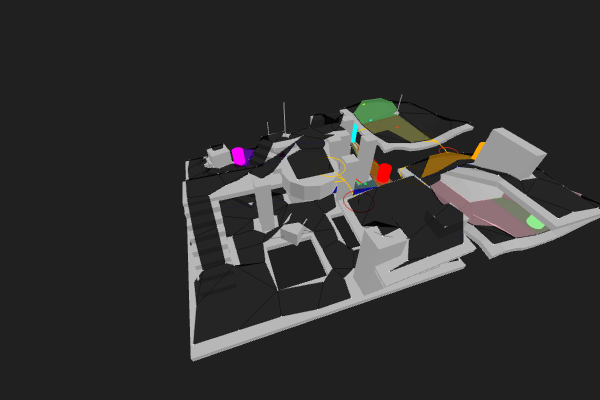<br/>
        Crowd Simulation
      </a><br/>
      <sub><a href="./demos/examples/example_crowd_simulation.cpp">source</a></sub>
    </td>
    <td align="center">
      <a href="https://isaac-mason.github.io/roam/?example=example_navmesh_constrained_character_controller">
        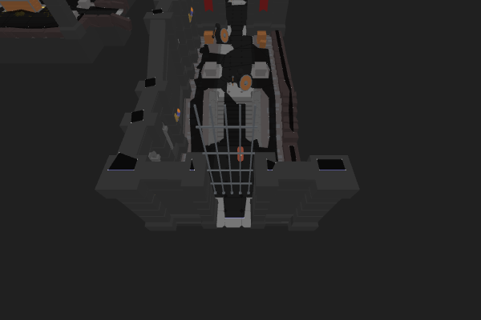<br/>
        NavMesh Constrained Character Controller
      </a><br/>
      <sub><a href="./demos/examples/example_navmesh_constrained_character_controller.cpp">source</a></sub>
    </td>
    <td align="center">
      <a href="https://isaac-mason.github.io/roam/?example=example_area_filters">
        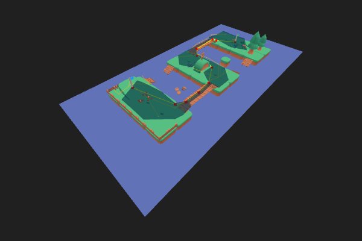<br/>
        Area Filters
      </a><br/>
      <sub><a href="./demos/examples/example_area_filters.cpp">source</a></sub>
    </td>
  </tr>
  <tr>
    <td align="center">
      <a href="https://isaac-mason.github.io/roam/?example=example_area_costs">
        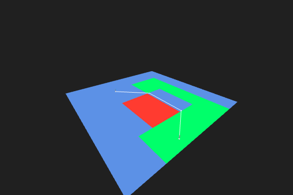<br/>
        Area Costs
      </a><br/>
      <sub><a href="./demos/examples/example_area_costs.cpp">source</a></sub>
    </td>
    <td align="center">
      <a href="https://isaac-mason.github.io/roam/?example=example_doors_and_keys">
        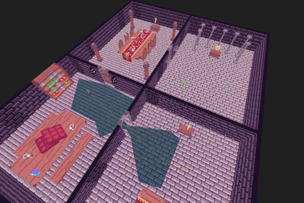<br/>
        Doors and Keys
      </a><br/>
      <sub><a href="./demos/examples/example_doors_and_keys.cpp">source</a></sub>
    </td>
    <td align="center">
      <a href="https://isaac-mason.github.io/roam/?example=example_multiple_agent_sizes">
        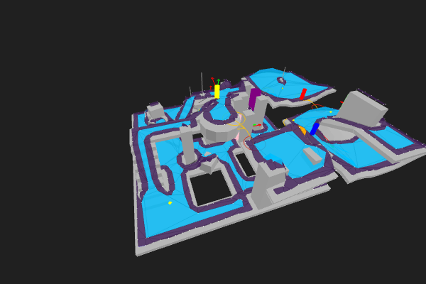<br/>
        Multiple Agent Sizes
      </a><br/>
      <sub><a href="./demos/examples/example_multiple_agent_sizes.cpp">source</a></sub>
    </td>
  </tr>
  <tr>
    <td align="center">
      <a href="https://isaac-mason.github.io/roam/?example=example_crowd_simulation_stress_test">
        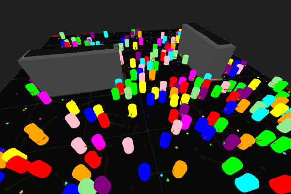<br/>
        Crowd Simulation Stress Test
      </a><br/>
      <sub><a href="./demos/examples/example_crowd_simulation_stress_test.cpp">source</a></sub>
    </td>
    <td align="center">
      <a href="https://isaac-mason.github.io/roam/?example=example_flow_field_pathfinding">
        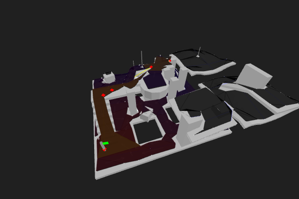<br/>
        Flow Field Pathfinding
      </a><br/>
      <sub><a href="./demos/examples/example_flow_field_pathfinding.cpp">source</a></sub>
    </td>
    <td align="center">
      <a href="https://isaac-mason.github.io/roam/?example=example_find_path">
        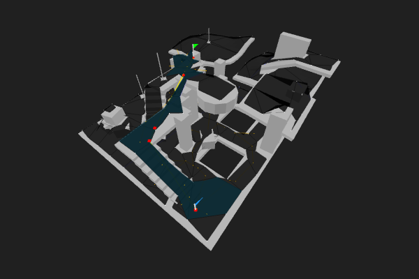<br/>
        Find Path
      </a><br/>
      <sub><a href="./demos/examples/example_find_path.cpp">source</a></sub>
    </td>
  </tr>
  <tr>
    <td align="center">
      <a href="https://isaac-mason.github.io/roam/?example=example_find_node_path">
        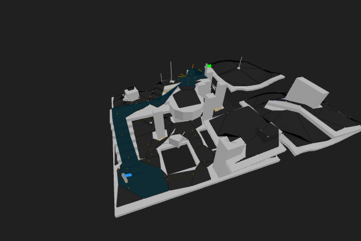<br/>
        Find Node Path
      </a><br/>
      <sub><a href="./demos/examples/example_find_node_path.cpp">source</a></sub>
    </td>
    <td align="center">
      <a href="https://isaac-mason.github.io/roam/?example=example_find_straight_path">
        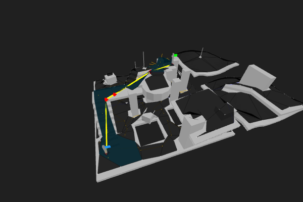<br/>
        Find Straight Path
      </a><br/>
      <sub><a href="./demos/examples/example_find_straight_path.cpp">source</a></sub>
    </td>
    <td align="center">
      <a href="https://isaac-mason.github.io/roam/?example=example_find_smooth_path">
        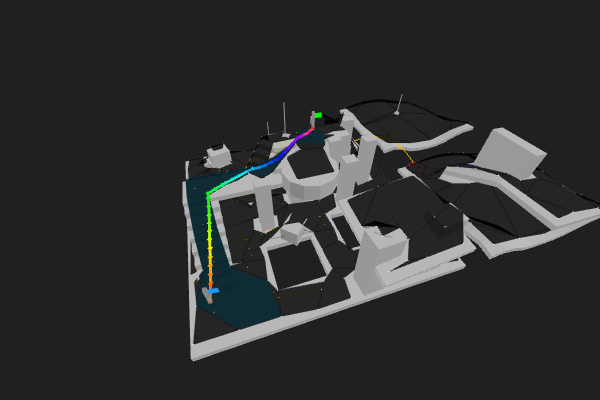<br/>
        Find Smooth Path
      </a><br/>
      <sub><a href="./demos/examples/example_find_smooth_path.cpp">source</a></sub>
    </td>
  </tr>
  <tr>
    <td align="center">
      <a href="https://isaac-mason.github.io/roam/?example=example_find_shortest_paths">
        <br/>
        Find Shortest Paths
      </a><br/>
      <sub><a href="./demos/examples/example_find_shortest_paths.cpp">source</a></sub>
    </td>
    <td align="center">
      <a href="https://isaac-mason.github.io/roam/?example=example_find_diverse_paths">
        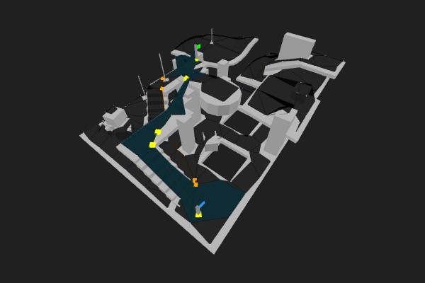<br/>
        Find Diverse Paths
      </a><br/>
      <sub><a href="./demos/examples/example_find_diverse_paths.cpp">source</a></sub>
    </td>
    <td align="center">
      <a href="https://isaac-mason.github.io/roam/?example=example_raycast">
        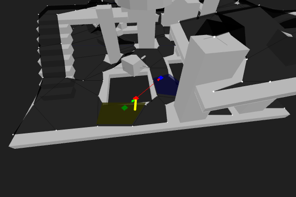<br/>
        Raycast
      </a><br/>
      <sub><a href="./demos/examples/example_raycast.cpp">source</a></sub>
    </td>
  </tr>
  <tr>
    <td align="center">
      <a href="https://isaac-mason.github.io/roam/?example=example_off_mesh_connections">
        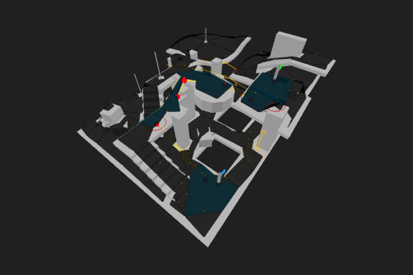<br/>
        Off-Mesh Connections
      </a><br/>
      <sub><a href="./demos/examples/example_off_mesh_connections.cpp">source</a></sub>
    </td>
    <td align="center">
      <a href="https://isaac-mason.github.io/roam/?example=example_segment_off_mesh_connections">
        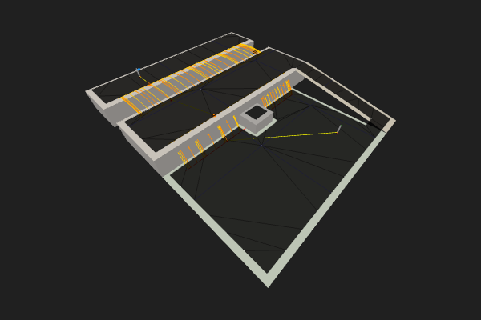<br/>
        Segment Off-Mesh Connections
      </a><br/>
      <sub><a href="./demos/examples/example_segment_off_mesh_connections.cpp">source</a></sub>
    </td>
    <td align="center">
      <a href="https://isaac-mason.github.io/roam/?example=example_upload_model">
        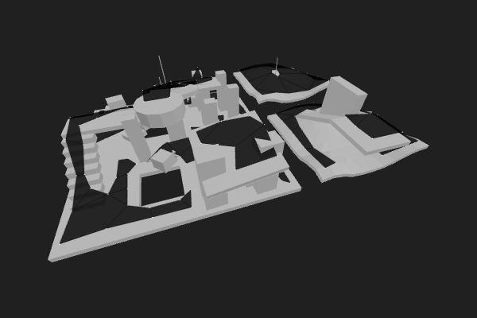<br/>
        Upload Model
      </a><br/>
      <sub><a href="./demos/examples/example_upload_model.cpp">source</a></sub>
    </td>
  </tr>
  <tr>
    <td align="center">
      <a href="https://isaac-mason.github.io/roam/?example=example_custom_gltf_nav_mesh">
        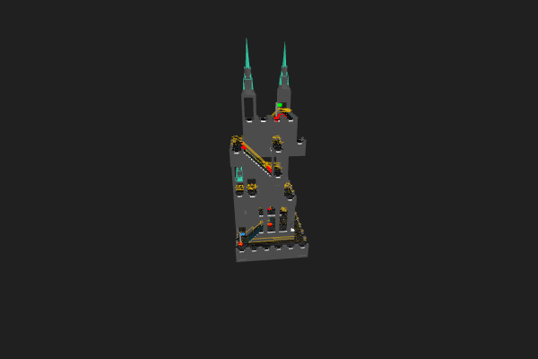<br/>
        Custom GLTF NavMesh
      </a><br/>
      <sub><a href="./demos/examples/example_custom_gltf_nav_mesh.cpp">source</a></sub>
    </td>
    <td align="center">
      <a href="https://isaac-mason.github.io/roam/?example=example_solo_nav_mesh">
        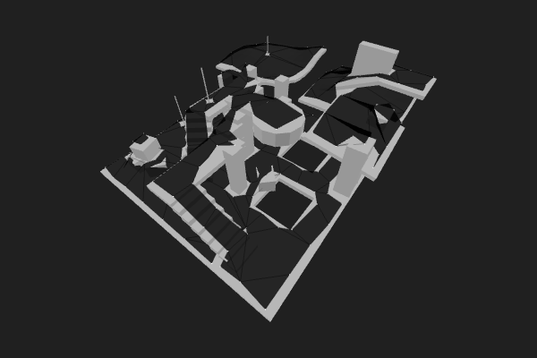<br/>
        Solo NavMesh
      </a><br/>
      <sub><a href="./demos/examples/example_solo_nav_mesh.cpp">source</a></sub>
    </td>
    <td align="center">
      <a href="https://isaac-mason.github.io/roam/?example=example_tiled_nav_mesh">
        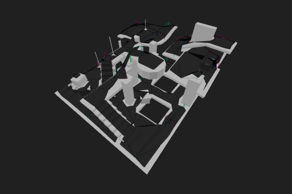<br/>
        Tiled NavMesh
      </a><br/>
      <sub><a href="./demos/examples/example_tiled_nav_mesh.cpp">source</a></sub>
    </td>
  </tr>
  <tr>
    <td align="center">
      <a href="https://isaac-mason.github.io/roam/?example=example_flood_fill_pruning">
        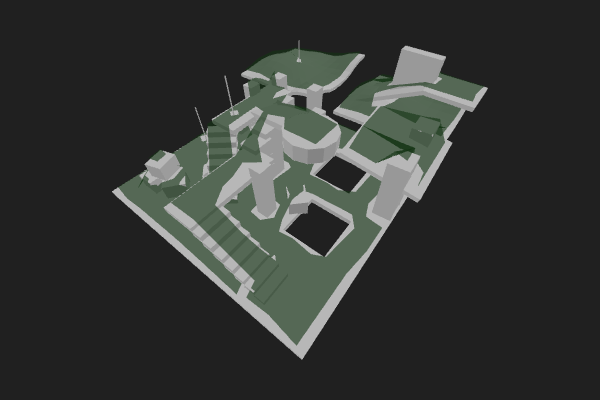<br/>
        Flood Fill Pruning
      </a><br/>
      <sub><a href="./demos/examples/example_flood_fill_pruning.cpp">source</a></sub>
    </td>
    <td align="center">
      <a href="https://isaac-mason.github.io/roam/?example=example_find_nearest_poly">
        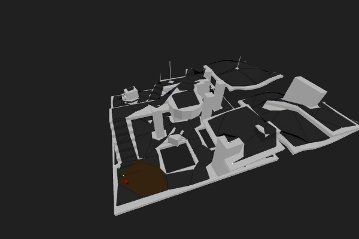<br/>
        Find Nearest Poly
      </a><br/>
      <sub><a href="./demos/examples/example_find_nearest_poly.cpp">source</a></sub>
    </td>
    <td align="center">
      <a href="https://isaac-mason.github.io/roam/?example=example_find_random_point">
        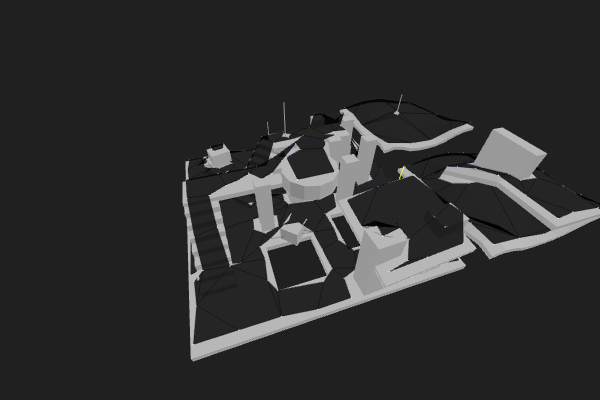<br/>
        Find Random Point
      </a><br/>
      <sub><a href="./demos/examples/example_find_random_point.cpp">source</a></sub>
    </td>
  </tr>
  <tr>
    <td align="center">
      <a href="https://isaac-mason.github.io/roam/?example=example_find_random_point_around_circle">
        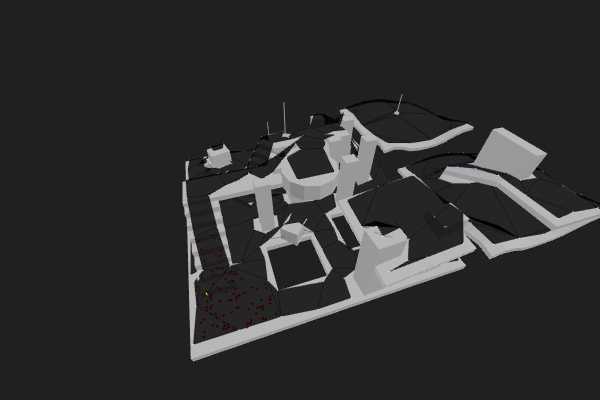<br/>
        Find Random Point Around Circle
      </a><br/>
      <sub><a href="./demos/examples/example_find_random_point_around_circle.cpp">source</a></sub>
    </td>
    <td align="center">
      <a href="https://isaac-mason.github.io/roam/?example=example_mark_compact_heightfield_areas">
        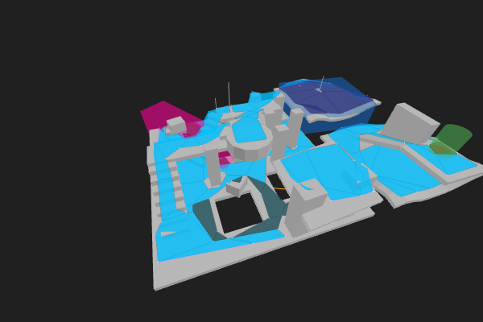<br/>
        Mark Compact Heightfield Areas
      </a><br/>
      <sub><a href="./demos/examples/example_mark_compact_heightfield_areas.cpp">source</a></sub>
    </td>
    <td align="center">
      <a href="https://isaac-mason.github.io/roam/?example=example_custom_nav_mesh_generation">
        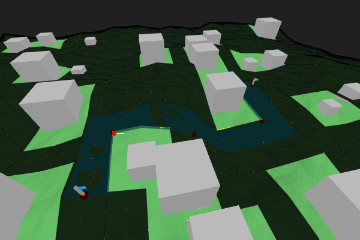<br/>
        Custom NavMesh Generation
      </a><br/>
      <sub><a href="./demos/examples/example_custom_nav_mesh_generation.cpp">source</a></sub>
    </td>
  </tr>
  <tr>
    <td align="center">
      <a href="https://isaac-mason.github.io/roam/?example=example_move_along_surface">
        <br/>
        Move Along Surface
      </a><br/>
      <sub><a href="./demos/examples/example_move_along_surface.cpp">source</a></sub>
    </td>
    <td align="center">
      <a href="https://isaac-mason.github.io/roam/?example=example_chunky_tri_mesh">
        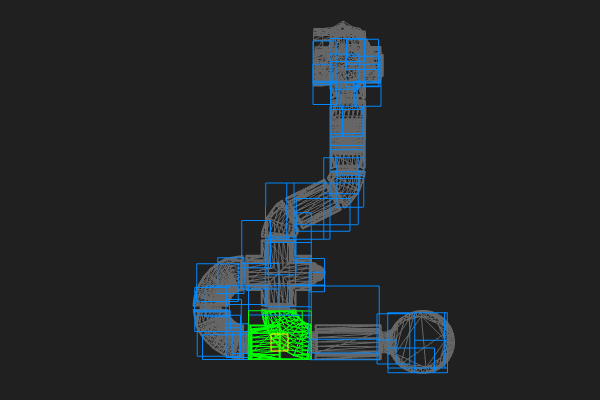<br/>
        Chunky Tri Mesh
      </a><br/>
      <sub><a href="./demos/examples/example_chunky_tri_mesh.cpp">source</a></sub>
    </td>
    <td align="center">
      <a href="https://isaac-mason.github.io/roam/?example=example_rasterize_filled_volume">
        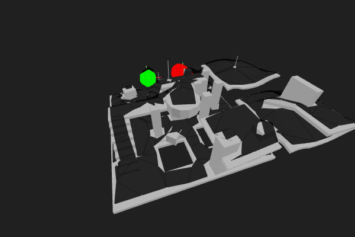<br/>
        Rasterize Filled Volume
      </a><br/>
      <sub><a href="./demos/examples/example_rasterize_filled_volume.cpp">source</a></sub>
    </td>
  </tr>
</table>

## Table of Contents

- [What is a Navigation Mesh?](#what-is-a-navigation-mesh)
- [Can roam be integrated with my engine?](#can-roam-be-integrated-with-my-engine)
- [Getting roam](#getting-roam)
  - [CMake](#cmake)
  - [Without CMake](#without-cmake)
- [Quick Start / Minimal Example](#quick-start--minimal-example)
- [Reading the API](#reading-the-api)
  - [Conventions](#conventions)
  - [Results and spans](#results-and-spans)
  - [Public headers](#public-headers)
- [Memory](#memory)
  - [Errors](#errors)
- [Navigation Mesh Querying](#navigation-mesh-querying)
  - [`find_path`](#find_path)
  - [`find_smooth_path`](#find_smooth_path)
  - [`find_node_path`](#find_node_path)
  - [`find_straight_path`](#find_straight_path)
  - [Sliced searches](#sliced-searches)
  - [`move_along_surface`](#move_along_surface)
  - [`raycast` & `raycast_with_costs`](#raycast--raycast_with_costs)
  - [`find_nearest_poly`](#find_nearest_poly)
  - [`find_random_point` & `find_random_point_around_circle`](#find_random_point--find_random_point_around_circle)
  - [`is_reachable`](#is_reachable)
  - [`find_local_neighbourhood`](#find_local_neighbourhood)
- [Crowd Simulation](#crowd-simulation)
  - [Off-mesh connections in a crowd](#off-mesh-connections-in-a-crowd)
  - [Path corridors](#path-corridors)
- [Custom Pathfinding Algorithms](#custom-pathfinding-algorithms)
- [Navigation Mesh Generation](#navigation-mesh-generation)
  - [Overview](#overview)
    - [The Structure of a Navigation Mesh](#the-structure-of-a-navigation-mesh)
    - [Single-Tile vs Tiled Navigation Meshes](#single-tile-vs-tiled-navigation-meshes)
  - [Generation presets: half library, half example](#generation-presets-half-library-half-example)
    - [Solo nav meshes](#solo-nav-meshes)
    - [Tiled nav meshes](#tiled-nav-meshes)
    - [Ejecting](#ejecting)
  - [Generation Process: Deep Dive](#generation-process-deep-dive)
    - [0. Input and setup](#0-input-and-setup)
    - [1. Mark walkable triangles](#1-mark-walkable-triangles)
    - [2. Rasterize triangles into a heightfield, do filtering with the heightfield](#2-rasterize-triangles-into-a-heightfield-do-filtering-with-the-heightfield)
    - [3. Build compact heightfield, erode walkable area, mark areas](#3-build-compact-heightfield-erode-walkable-area-mark-areas)
    - [4. Build compact heightfield regions](#4-build-compact-heightfield-regions)
    - [5. Build contours from compact heightfield regions](#5-build-contours-from-compact-heightfield-regions)
    - [6. Build polygon mesh from contours, build detail mesh](#6-build-polygon-mesh-from-contours-build-detail-mesh)
    - [7. Convert build-time poly mesh and poly mesh detail to runtime navmesh tile format](#7-convert-build-time-poly-mesh-and-poly-mesh-detail-to-runtime-navmesh-tile-format)
    - [8. Assemble the navigation mesh](#8-assemble-the-navigation-mesh)
  - [Post-Processing](#post-processing)
  - [Custom Query Filters and Custom Area Types](#custom-query-filters-and-custom-area-types)
  - [Off-Mesh Connections](#off-mesh-connections)
    - [Point connections](#point-connections)
    - [Segment connections](#segment-connections)
- [Advanced Navigation Mesh APIs](#advanced-navigation-mesh-apis)
  - [Nodes and refs](#nodes-and-refs)
  - [Tiles](#tiles)
  - [Polys](#polys)
- [Using Externally Created Navigation Meshes](#using-externally-created-navigation-meshes)
- [Saving and Loading NavMeshes](#saving-and-loading-navmeshes)
- [Geometry Blocks](#geometry-blocks)
- [Debug Utilities](#debug-utilities)
- [Demos](#demos)
- [Tests and Benchmarks](#tests-and-benchmarks)
- [License](#license)

## What is a Navigation Mesh?

A navigation mesh (or navmesh) is a simplified representation of a 3D environment that is used for pathfinding and AI
navigation in games and simulations. It consists of interconnected convex polygons that cover the walkable areas of the
environment. Polygons are connected by their shared edges and by off-mesh connections, allowing agents (characters) to
move from one polygon to another.

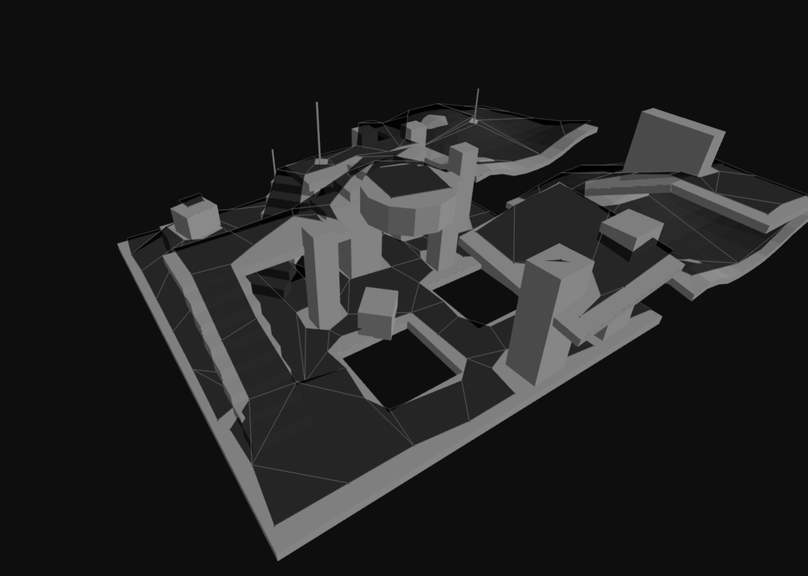

## Can roam be integrated with my engine?

roam knows nothing of rendering, physics or any engine, so it works with whichever you use, or your own. It takes
triangles in and gives positions, polygons and paths out. The debug helpers turn its data into plain triangles, lines,
points and boxes for you to draw however you draw things.

roam's conventions:

- Positions are `Vec3 {x, y, z}` with y up, in a right-handed coordinate system, as in OpenGL.
- Triangles are wound counter clockwise seen from above.
- `float` everywhere. The examples use metres, but roam has no units of its own.

If your environment uses a different coordinate system, transform coordinates going into and out of roam.

If you are importing a navmesh created externally, its polygons must share vertices where they meet: neighbours are
found by shared edges.

## Getting roam

### CMake

roam's `CMakeLists.txt` makes two libraries:

- `roam` (alias `roam::roam`): generation, queries and debug drawing.
- `roam_blocks` (alias `roam::blocks`): the generators, agents and helpers built on `roam`. It links
  `roam`.

Fetch roam, or add a checkout (a git submodule, say) with `add_subdirectory(path/to/roam)`, then link a target. roam's
headers need C++20, and linking either target asks for it:

```cmake
cmake_minimum_required(VERSION 3.24)
project(game LANGUAGES CXX)

include(FetchContent)
FetchContent_Declare(roam GIT_REPOSITORY https://github.com/isaac-mason/roam.git GIT_TAG main)
FetchContent_MakeAvailable(roam)

add_executable(game main.cpp)
target_link_libraries(game PRIVATE roam::blocks)
```

Once you have ejected every block you use, link `roam::roam` alone.

The tests and benchmarks build only when roam is the top-level project. Its options:

- `ROAM_BUILD_TESTS` and `ROAM_BUILD_BENCH`: the tests and the benchmarks.
- `ROAM_BUILD_DEMOS`: the demo app, which fetches sokol, Dear ImGui and cgltf. Off by default.

### Without CMake

Compile every `.cpp` under `roam/` with the repository root on the include path (headers are included as
`"roam/query/nav_mesh_api.h"`), as C++20. Leave out `roam/blocks/` if you use none of it. roam's own targets build with
`-fno-exceptions -fno-rtti -ffp-contract=off`; the last keeps results from depending on whether the compiler fuses
multiply-adds.

```sh
c++ -std=c++20 -O2 -fno-exceptions -fno-rtti -ffp-contract=off -I path/to/roam main.cpp $(find path/to/roam/roam -name '*.cpp')
```

## Quick Start / Minimal Example

Below is a minimal example of using the `generate_solo_nav_mesh` block to generate a navigation mesh, and then using
roam's core to find a path on it: a floor with a block in the middle, and a path from one side of the block to the
other.

For how to tune these options, and how the generation process works under the hood with images, see the
[Navigation Mesh Generation](#navigation-mesh-generation) section below.

```cpp
#include <stdio.h>

#include "roam/blocks/generators/generate_solo_nav_mesh.h"
#include "roam/query/find_path.h"

using namespace roam;

int main() {
    // your level geometry: leave out what shouldn't contribute to walkable surfaces, like foliage
    // or small decorative props. here, a 20 m floor with a 4 m wide, 2 m tall block in the middle,
    // triangles wound counter clockwise from above
    const float positions[] = {
        -10, 0, -10, 10, 0, -10, 10, 0, 10, -10, 0, 10,
        -2, 0, -2, 2, 0, -2, 2, 0, 2, -2, 0, 2,
        -2, 2, -2, 2, 2, -2, 2, 2, 2, -2, 2, 2,
    };
    const uint32_t indices[] = {
        0, 2, 1, 0, 3, 2,
        8, 10, 9, 8, 11, 10,
        4, 9, 5, 4, 8, 9, 5, 10, 6, 5, 9, 10,
        6, 11, 7, 6, 10, 11, 7, 8, 4, 7, 11, 8,
    };
    const InputTriangleMesh level = {positions, indices};

    // defaults for a human-sized agent in a 1 m scale world: voxels of 0.2 m, for an agent 0.3 m
    // in radius and 1.8 m tall, which can climb 0.4 m and walk up 45 degree slopes. use the debug
    // helpers to see each stage of generation and fine tune these
    const float cell_size = 0.2f;
    const float cell_height = 0.2f;
    const SoloNavMeshOptions options = generate_solo_nav_mesh::derive_sizes({
        .cell_size = cell_size,
        .cell_height = cell_height,
        .walkable_radius_world = 0.3f,
        .walkable_climb_world = 0.4f,
        .walkable_height_world = 1.8f,
        .walkable_slope_angle_degrees = 45,
        .border_size = 0,
        .min_region_area = 8,
        .merge_region_area = 20,
        .max_simplification_error = 1.3f,
        .max_edge_length = 12,
        .max_vertices_per_poly = 6,
        .detail_sample_distance = 6 * cell_size,
        .detail_sample_max_error = 1 * cell_height,
    });

    // generate the nav mesh. every stage is kept in the intermediates, for debugging: let them go
    SoloNavMeshResult result = generate_solo_nav_mesh::generate_solo_nav_mesh(level, options);
    generate_solo_nav_mesh::release(result.intermediates);
    NavMesh &nav_mesh = result.nav_mesh;

    // find a path: the start and end are snapped to the nav mesh within the half extents, and
    // the path's corners are written into the points buffer
    const Vec3 start = {-8, 0, 0};
    const Vec3 end = {8, 0, 0};
    const Vec3 half_extents = {1, 1, 1};
    const QueryFilter &filter = nav_mesh_api::DEFAULT_QUERY_FILTER;

    QueryWorkspace workspace = nav_mesh_search::create_query_workspace();
    StraightPathPoint points[64];
    FindPathResult path = {};
    find_path::find_path(path, workspace, nav_mesh, start, end, half_extents, filter, points);

    printf("%s, %u points\n", path.success ? "found a path" : "no path", path.point_count);
    for (uint32_t i = 0; i < path.point_count; i++) {
        const Vec3 point = points[i].position;
        printf("  %.2f %.2f %.2f\n", point.x, point.y, point.z);
    }

    nav_mesh_search::release(workspace);
    nav_mesh_api::release(nav_mesh);
    return 0;
}
```

It prints the path's corners, from the start, around the block and on to the end:

```
found a path, 4 points
  -8.00 0.20 0.00
  -2.20 0.20 2.60
  2.20 0.20 2.60
  8.00 0.20 0.00
```

Below is a quick summary of the generation options used above, and how to start tuning them:

| Option | Description | Range / heuristic for 1 = 1 m humanoid agents |
| --- | --- | --- |
| `cell_size` | Horizontal voxel size (XZ). Smaller = finer detail, slower generation. | ≈ `walkable_radius_world / 3` |
| `cell_height` | Vertical voxel size (Y). Controls height resolution. | ≈ `walkable_climb_world / 2` |
| `walkable_radius_world` | Agent radius. The walkable area is eroded by it, so paths keep the agent's body off walls. | 0.2–0.5 m |
| `walkable_height_world` | Agent height. Areas with ceilings lower than this are excluded. | 1.6–2.0 m |
| `walkable_slope_angle_degrees` | Steepest walkable slope. This filters input triangles at the very start of generation. | 35–50° |
| `walkable_climb_world` | Max step height, up or down. This filters at the heightfield stage. | 0.3–0.5 m |
| `border_size` | Voxels of padding around each tile. 0 for a solo nav mesh. | tiled: `walkable_radius_voxels + 3` |
| `min_region_area` | Smallest isolated region kept, in voxels. | 4–16 |
| `merge_region_area` | Regions smaller than this merge into neighbours, in voxels. | 8–32 |
| `max_simplification_error` | How far, in voxels, simplified outlines may stray from the voxels (higher = simpler mesh). | 1–2 |
| `max_edge_length` | Longest polygon edge along walls before it is split, in voxels. 0 for no limit. | 8–24 |
| `max_vertices_per_poly` | Max vertices per polygon. 3 gives triangles. | 3–6 |
| `detail_sample_distance` | Distance between height samples for the detail mesh. | `cell_size * 4–8` |
| `detail_sample_max_error` | Allowed height deviation of the detail mesh from its samples. | `cell_height * 1–2` |

Each agent measure has a voxel field and a world field: the voxels drive the build, and the world values are kept in
the tiles. `derive_sizes` fills the voxel fields from the world ones, rounding up; set them yourself to choose
otherwise.

The rest of this guide leaves out the includes and `using namespace roam;`. Most of its examples share one level, the
quick start's floor and block plus a platform 1 m up, its triangles in `Array`s:

```cpp
// a box's top and four sides, wound to face out
static void add_box(Array<float> &positions, Array<uint32_t> &indices, Vec3 min, Vec3 max) {
    uint32_t base = positions.length / 3;
    for (int i = 0; i < 8; i++) {
        positions.push((i & 1) ? max.x : min.x);
        positions.push((i & 2) ? max.y : min.y);
        positions.push((i & 4) ? max.z : min.z);
    }
    const uint32_t faces[] = {
        2, 6, 7, 2, 7, 3,
        0, 2, 3, 0, 3, 1,
        4, 5, 7, 4, 7, 6,
        0, 4, 6, 0, 6, 2,
        1, 3, 7, 1, 7, 5,
    };
    for (uint32_t index : faces) indices.push(base + index);
}

Level create_level() {
    Level level = {};
    const float floor[] = {-10, 0, -10, 10, 0, -10, 10, 0, 10, -10, 0, 10};
    for (float value : floor) level.positions.push(value);
    const uint32_t floor_indices[] = {0, 2, 1, 0, 3, 2};
    for (uint32_t index : floor_indices) level.indices.push(index);
    // a block in the middle to walk around, and a platform 1 m up that the floor does not reach
    add_box(level.positions, level.indices, {-2, 0, -2}, {2, 2, 2});
    add_box(level.positions, level.indices, {4, 0, -9}, {9, 1, -5});
    return level;
}
```

## Reading the API

### Conventions

- Everything is in `namespace roam`. Types are directly in it (`NavMesh`, `QueryFilter`, `StraightPathPoint`). Functions
  and constants are in a namespace per module, named after its header: `nav_mesh_api::add_tile` is in
  `roam/query/nav_mesh_api.h`, `find_path::find_path` in `roam/query/find_path.h`. Folders are only for finding files.
- Functions are snake_case, types PascalCase, constants and enum values UPPER_SNAKE_CASE: `NODE_TYPE_OFFMESH`,
  `OFF_MESH_CONNECTION_DIRECTION_BIDIRECTIONAL`.
- Data is plain structs and their fields are yours to read. Settings structs take designated initializers, which C++20
  requires in declaration order.
- A function that builds or changes something takes it first (after a `BuildContext` when it logs):
  `heightfield::rasterize_triangles(context, heightfield, ...)`, `nav_mesh_api::add_tile(nav_mesh, tile)`.
- Lifecycles: `create` makes something that owns memory, and `release` frees what a value holds.
  `nav_mesh_api::create_nav_mesh` and `nav_mesh_api::release`, `crowd::create` and `crowd::release`. Only what you
  create owns memory. See [Memory](#memory).
- Math returns by value: `vec3::add(a, b)`, `box3::expand_by_point(box, point)`.

### Results and spans

Queries write their result into `out`, their first parameter. A result is a plain value: flags, refs, positions and
counts. It never owns memory, so it needs no release, and it can be reused from call to call.

Anything of variable size goes into a buffer of yours, passed as a `Span<T>`: a pointer and a `length`. A span converts
from a C array, from an `Array` (roam's growable array), or is built as `{data, length}`. A writable span of an
`Array` covers its capacity; a read-only one, `Span<const T>`, covers its length. Here with `start` and `end` from
[`find_nearest_poly`](#find_nearest_poly):

```cpp
// a C array: its size is the span's length
NodeRef fixed[256];
FindNodePathResult path = {};
nav_mesh_search::find_node_path(path, workspace, nav_mesh, start.node_ref, end.node_ref,
                                start.position, end.position, filter, fixed);

// an Array: a writable span covers its capacity, so reserve, pass it, then resize to what
// was written
Array<NodeRef> grown = {};
grown.reserve(16);
nav_mesh_search::find_node_path(path, workspace, nav_mesh, start.node_ref, end.node_ref,
                                start.position, end.position, filter, grown);
grown.resize(path.path_count);

// a pointer and a length, and a read-only span of the refs written so far
NodeRef *heap = memory::allocate_array<NodeRef>(256);
nav_mesh_search::find_node_path(path, workspace, nav_mesh, start.node_ref, end.node_ref,
                                start.position, end.position, filter, {heap, 256});
Span<const NodeRef> written = {heap, path.path_count};
```

A result names its counts after the buffer: `path_count` is how many it wrote, `path_total` the true size where that
is known, and `truncated` says the buffer filled up. Searches take a `QueryWorkspace &` after `out`: the search nodes
and scratch arrays they reuse from call to call, so that a warm query allocates nothing. A workspace serves one query
at a time.

### Public headers

roam's headers are its API: there are no private ones. The ones most programs use:

- **Generation:** `blocks/generators/generate_solo_nav_mesh.h` and `generate_tiled_nav_mesh.h`, and for a pipeline of
  your own, the headers under `generate/`: `input_triangle_mesh.h`, `heightfield.h`, `compact_heightfield.h`,
  `compact_heightfield_regions.h`, `contour_set.h`, `poly_mesh.h`, `poly_mesh_detail.h` and `nav_mesh_tile.h`.
- **The nav mesh:** `query/nav_mesh.h` (its structs), `query/nav_mesh_api.h` (tiles, off-mesh connections, nearest
  polys, filters) and `query/nav_mesh_io.h` (saving and loading).
- **Queries:** `query/nav_mesh_search.h` (node paths, raycasts, moving along the surface, random points,
  reachability), `query/find_path.h`, `query/find_straight_path.h`, `query/find_smooth_path.h` and
  `query/local_neighbourhood.h`.
- **Agents:** `blocks/agents/crowd.h`, `path_corridor.h`, `local_boundary.h` and `obstacle_avoidance.h`.
- **The rest:** `debug/debug.h`, `blocks/search/flood_fill_nav_mesh.h`, `blocks/geometry/`, and `util/` and `math/`.

## Memory

roam takes all its memory through one allocator, `malloc` and `free` to start with. Set your own before anything
allocates. Every block comes back with the size and alignment it was asked for, so your allocator needs no headers of
its own. roam asks for at most `alignof(max_align_t)`:

```cpp
struct CountingAllocator {
    size_t bytes;
    size_t peak;
};

void *counting_allocate(size_t size, size_t alignment, void *user_data) {
    (void)alignment;
    CountingAllocator &counter = *static_cast<CountingAllocator *>(user_data);
    counter.bytes += size;
    if (counter.bytes > counter.peak) counter.peak = counter.bytes;
    return malloc(size);
}

void counting_free(void *block, size_t size, size_t alignment, void *user_data) {
    (void)alignment;
    static_cast<CountingAllocator *>(user_data)->bytes -= size;
    free(block);
}
```

```cpp
static CountingAllocator counter = {};
memory::set_allocator({counting_allocate, counting_free, &counter});
```

What owns memory: anything made by a `create` (a nav mesh, a workspace, a crowd, a corridor, a heightfield), the
generators' results and intermediates, and `Array`s. Each is freed by its module's `release`: `nav_mesh_api::release`,
`nav_mesh_search::release`, `crowd::release`, `generate_solo_nav_mesh::release`, `heightfield::release`, or an
`Array`'s own `release()`. Results, spans, `QueryFilter`s, params and settings hold no memory.

roam built for debug, or with `ROAM_TRACK_MEMORY` defined, counts what it holds:

```cpp
printf("%zu bytes in use, %zu at most\n", counter.bytes, counter.peak);
if (memory::tracking_enabled()) {
    MemoryStats stats = memory::outstanding();
    printf("%lld allocations, %lld bytes\n", (long long)stats.allocations, (long long)stats.bytes);
}
```

`Scoped<T>` (`roam/util/scoped.h`) is an opt-in holder that releases a value as it leaves scope, for code that wants it:

```cpp
{
    Scoped<NavMesh> nav_mesh(nav_mesh_api::release);
    const InputTriangleMesh mesh = {level.positions, level.indices};
    SoloNavMeshResult result = generate_solo_nav_mesh::generate_solo_nav_mesh(mesh, options);
    generate_solo_nav_mesh::release(result.intermediates);
    *nav_mesh = result.nav_mesh;
    printf("%u tiles\n", nav_mesh->tiles.length);
}
```

### Errors

Running out of memory stops the program: when the allocator returns null, roam prints the size it asked for and
aborts. Nothing in roam fails for want of memory, so nothing checks for it.

Everything else that can fail says so in its result: `success` and `flags` on a query's result, a `bool` from a
generation step, a `LoadStatus` from loading. Generation steps that fail log why in their `BuildContext`. Invalid and
stale refs, positions far outside the nav mesh and NaNs are failures, not crashes. `ROAM_ASSERT` checks roam's own
invariants in debug builds, and in release builds with `ROAM_ENABLE_ASSERTS` defined.

## Navigation Mesh Querying

This section covers the main features you'll use for navigation mesh querying: pathfinding, spatial queries and
surface movement. For lower-level APIs and the nav mesh's internals, see
[Advanced Navigation Mesh APIs](#advanced-navigation-mesh-apis).

Queries take a `QueryFilter`, which says which polys a query may use and what crossing them costs. Use
`nav_mesh_api::DEFAULT_QUERY_FILTER` (every poly with any flag set, costed by distance) until you need your own; see
[Custom Query Filters and Custom Area Types](#custom-query-filters-and-custom-area-types). The examples here use the
shared level's solo nav mesh, a `QueryWorkspace` and the default filter, as `filter`.

### `find_path`

`find_path` is the whole of a path in one call: `find_nearest_poly` for the start and end, `find_node_path` between
them, and `find_straight_path` for the node path's corners. Its points are where an agent turns, and where it goes onto
an off-mesh connection.

**When to use:** This is the simplest way to find a complete path. Use it for one-off pathfinding queries, or when you
aren't steering agents along a path and re-querying frequently.

```cpp
const Vec3 start = {-8, 0, 0};
const Vec3 end = {8, 0, 0};
const Vec3 half_extents = {1, 1, 1};

// nearest polys for both ends, a node path between them, and its corners, in one call
StraightPathPoint points[64];
NodeRef node_path[256];
FindPathResult path = {};
find_path::find_path(path, workspace, nav_mesh, start, end, half_extents, filter, points,
                     {.node_path = node_path});

if (path.flags & FIND_PATH_RESULT_PARTIAL_PATH) printf("out of reach: as near as it can\n");
if (path.flags & FIND_PATH_RESULT_MAX_POINTS_REACHED) printf("more than 64 corners\n");
for (uint32_t i = 0; i < path.point_count; i++) {
    const Vec3 point = points[i].position;
    const bool off_mesh = points[i].type == NODE_TYPE_OFFMESH;
    printf("%.2f %.2f %.2f%s\n", point.x, point.y, point.z, off_mesh ? ", off-mesh" : "");
}
```

`truncated` is set when the points buffer or a node path buffer you pass fills up. When the end cannot be reached, the
path goes to the reachable poly nearest it, `success` is still true, and `flags` has `FIND_PATH_RESULT_PARTIAL_PATH`.

```cpp
// raycast_distance: the search shortcuts through open space within this distance, where it
// can see
find_path::find_path(path, workspace, nav_mesh, start, end, half_extents, filter, points,
                     {.raycast_distance = 10});
```

<table>
  <tr>
    <td align="center">
      <a href="https://isaac-mason.github.io/roam/?example=example_find_path">
        <br/>
        <strong>Find Path</strong>
      </a><br/>
      <sub><a href="./demos/examples/example_find_path.cpp">source</a></sub>
    </td>
  </tr>
</table>

### `find_smooth_path`

`find_smooth_path` combines `find_node_path`, `find_straight_path` and `move_along_surface`: it walks the path in small
steps along the surface, each point on the detail mesh.

**When to use:** When you want a path that follows hills and stairs without sharp corners, and you need it
infrequently, such as for drawing a preview rather than for many agents a frame.

```cpp
// the path walked in steps of 0.5 m along the surface, each point on the detail mesh. slop
// is how near a corner counts as reached
SmoothPathPoint points[512];
FindSmoothPathResult path = {};
find_smooth_path::find_smooth_path(path, workspace, nav_mesh, start, end, half_extents, filter,
                                   points, {.step_size = 0.5f, .slop = 0.01f});
```

<table>
  <tr>
    <td align="center">
      <a href="https://isaac-mason.github.io/roam/?example=example_find_smooth_path">
        <br/>
        <strong>Find Smooth Path</strong>
      </a><br/>
      <sub><a href="./demos/examples/example_find_smooth_path.cpp">source</a></sub>
    </td>
  </tr>
</table>

### `find_node_path`

`find_node_path` is the search alone: the polys and off-mesh connections from start to end, by A* over the nav mesh's
graph.

**When to use:** When you want to keep a node path and recalculate its straight path many times, such as for an agent
whose position changes while its destination stays the same. This is cheaper than calling `find_path` again and again.

```cpp
const Vec3 half_extents = {1, 1, 1};
FindNearestPolyResult start = {};
nav_mesh_api::find_nearest_poly(start, nav_mesh, {-8, 0, 0}, half_extents, filter);
FindNearestPolyResult end = {};
nav_mesh_api::find_nearest_poly(end, nav_mesh, {8, 0, 0}, half_extents, filter);

// the polys and off-mesh connections from start to end, A* over the nav mesh's graph
Array<NodeRef> node_path = {};
node_path.reserve(4);
FindNodePathResult path = {};
nav_mesh_search::find_node_path(path, workspace, nav_mesh, start.node_ref, end.node_ref,
                                start.position, end.position, filter, node_path);

// path_total is its true length: grow and copy it out of the workspace, without searching
// again
if (path.truncated) {
    node_path.reserve(path.path_total);
    nav_mesh_search::copy_last_node_path(path, workspace, node_path);
}
node_path.resize(path.path_count);
```

<table>
  <tr>
    <td align="center">
      <a href="https://isaac-mason.github.io/roam/?example=example_find_node_path">
        <br/>
        <strong>Find Node Path</strong>
      </a><br/>
      <sub><a href="./demos/examples/example_find_node_path.cpp">source</a></sub>
    </td>
  </tr>
</table>

### `find_straight_path`

`find_straight_path` performs "string pulling" to turn a node path into the corners an agent should walk to, as
`find_path` does after its search. Each point says what it is in `flags` (`STRAIGHT_PATH_POINT_START`, `_END`,
`_OFFMESH`), its node's `type`, and the `node_ref` it leaves from. The start and end are clamped to the first and last
polys of the node path.

**When to use:** After `find_node_path`, to get the actual waypoints. You might call it often while keeping the same
node path, or when implementing path following of your own.

```cpp
// the node path string-pulled into corners. AREA_CROSSINGS adds a point where the path
// changes area, and ALL_CROSSINGS at every poly edge
StraightPathPoint points[64];
FindStraightPathResult straight = {};
find_straight_path::find_straight_path(straight, nav_mesh, start.position, end.position,
                                       node_path, points, FIND_STRAIGHT_PATH_AREA_CROSSINGS);
```

<table>
  <tr>
    <td align="center">
      <a href="https://isaac-mason.github.io/roam/?example=example_find_straight_path">
        <br/>
        <strong>Find Straight Path</strong>
      </a><br/>
      <sub><a href="./demos/examples/example_find_straight_path.cpp">source</a></sub>
    </td>
  </tr>
</table>

### Sliced searches

A sliced search runs a node path search a number of iterations at a time. The query holds its own search state, so
several can be in progress at once.

**When to use:** To spread long searches over frames so that no one frame pays for them. The crowd plans its agents'
paths this way.

```cpp
// a search spread over frames: a few iterations at a time until it is no longer in progress
SlicedNodePathQuery query = nav_mesh_search::create_sliced_node_path_query();
nav_mesh_search::init_sliced_find_node_path(query, nav_mesh, start.node_ref, end.node_ref,
                                            start.position, end.position, filter);
while (query.status & SLICED_FIND_NODE_PATH_IN_PROGRESS) {
    nav_mesh_search::update_sliced_find_node_path(query, nav_mesh, 10);
}

NodeRef node_path[256];
SlicedFindNodePathResult path = {};
nav_mesh_search::finalize_sliced_find_node_path(path, nav_mesh, query, node_path);
nav_mesh_search::release(query);
```

`finalize_sliced_find_node_path_partial` finishes a search early: the path to the furthest node of an existing path
that the search has reached.

### `move_along_surface`

`move_along_surface` moves a point across polys towards a target, sliding along the walls it meets and staying on the
nav mesh. It looks only at polys near the start, so keep moves short: a frame's worth.

**When to use:** For character controllers constrained to the nav mesh without full pathfinding: local movement,
sliding along walls, or movement logic of your own that respects the nav mesh.

```cpp
// a character controller's step: from where it is towards where its input would take it,
// sliding along walls and staying on the nav mesh. keep its poly ref between frames
FindNearestPolyResult start = {};
nav_mesh_api::find_nearest_poly(start, nav_mesh, {-4, 0, 0}, {1, 1, 1}, filter);
const Vec3 target = {0, 0, 0.5f};

NodeRef visited[16];
MoveAlongSurfaceResult move = {};
nav_mesh_search::move_along_surface(move, workspace, nav_mesh, start.node_ref, start.position,
                                    target, filter, visited);
if (move.success) {
    // the move is in 2D: the height is the detail mesh's under the new position
    GetPolyHeightResult height;
    nav_mesh_api::get_poly_height(height, nav_mesh, move.node_ref, move.position);
    Vec3 position = move.position;
    if (height.success) position.y = height.height;
    printf("now at %.2f %.2f %.2f\n", position.x, position.y, position.z);
}
```

<table>
  <tr>
    <td align="center">
      <a href="https://isaac-mason.github.io/roam/?example=example_navmesh_constrained_character_controller">
        <br/>
        <strong>NavMesh Constrained Character Controller</strong>
      </a><br/>
      <sub><a href="./demos/examples/example_navmesh_constrained_character_controller.cpp">source</a></sub>
    </td>
    <td align="center">
      <a href="https://isaac-mason.github.io/roam/?example=example_move_along_surface">
        <br/>
        <strong>Move Along Surface</strong>
      </a><br/>
      <sub><a href="./demos/examples/example_move_along_surface.cpp">source</a></sub>
    </td>
  </tr>
</table>

### `raycast` & `raycast_with_costs`

`raycast` walks a straight line across the nav mesh's surface (in 2D, ignoring height) from a point on a poly, and stops
at the first wall. `t` is how far along it got, from 0 to 1, or `FLT_MAX` when nothing stopped it.

**When to use:** Lines of sight across the ground, checking that a shortcut is walkable, finding walls. It is best
suited to short-range checks, given its two dimensional nature.

```cpp
// along the surface from a point on a poly, towards another: can an agent walk straight there?
const Vec3 end = {8, 0, 0};
NodeRef visited[64];
RaycastResult ray = {};
nav_mesh_search::raycast(ray, nav_mesh, start.node_ref, start.position, end, filter, visited);
if (ray.t == FLT_MAX) {
    printf("clear all the way\n");
} else {
    const Vec3 hit = vec3::lerp(start.position, end, ray.t);
    const Vec3 normal = ray.hit_normal;
    printf("blocked at %.2f %.2f, by a wall facing %.2f %.2f\n", hit.x, hit.z, normal.x, normal.z);
}
```

```cpp
// the same, adding up the filter's cost of the polys crossed. pass the poly you came from for
// accurate costs
const NodeRef previous = INVALID_NODE_REF;
nav_mesh_search::raycast_with_costs(ray, nav_mesh, start.node_ref, start.position, {-8, 0, 8},
                                    filter, previous, visited);
printf("costs %.2f\n", ray.path_cost);
```

<table>
  <tr>
    <td align="center">
      <a href="https://isaac-mason.github.io/roam/?example=example_raycast">
        <br/>
        <strong>Raycast</strong>
      </a><br/>
      <sub><a href="./demos/examples/example_raycast.cpp">source</a></sub>
    </td>
  </tr>
</table>

### `find_nearest_poly`

`find_nearest_poly` finds the poly nearest a point in the world, within a box of half extents around it, and the
nearest point on that poly.

**When to use:** This is often your first step: use it to snap world positions onto the nav mesh before pathfinding
or querying, when placing agents, or to check whether a position is on the nav mesh.

```cpp
// the poly nearest a point, within a box of these half extents around it, and the nearest
// point on it
const Vec3 position = {-6, 1, 3};
const Vec3 half_extents = {1, 2, 1};
FindNearestPolyResult nearest = {};
nav_mesh_api::find_nearest_poly(nearest, nav_mesh, position, half_extents, filter);
if (nearest.success) {
    const Vec3 at = nearest.position;
    printf("poly %llu at %.2f %.2f %.2f\n", (unsigned long long)nearest.node_ref, at.x, at.y, at.z);
}
```

<table>
  <tr>
    <td align="center">
      <a href="https://isaac-mason.github.io/roam/?example=example_find_nearest_poly">
        <br/>
        <strong>Find Nearest Poly</strong>
      </a><br/>
      <sub><a href="./demos/examples/example_find_nearest_poly.cpp">source</a></sub>
    </td>
  </tr>
</table>

### `find_random_point` & `find_random_point_around_circle`

`find_random_point` finds a random point anywhere on the nav mesh, polys weighted by area.
`find_random_point_around_circle` finds one within a radius of a point, through polys connected to its own.

**When to use:** Spawn points, patrol destinations, procedural placement, scatter formations, "move near the target"
behaviours.

Both take a function that returns a float in [0, 1), and its user data:

```cpp
// any generator that returns a float in [0, 1): here mulberry32, seeded
float next_random(void *user_data) {
    uint32_t &state = *static_cast<uint32_t *>(user_data);
    uint32_t t = state += 0x6d2b79f5u;
    t = (t ^ (t >> 15)) * (t | 1u);
    t ^= t + (t ^ (t >> 7)) * (t | 61u);
    return (float)((t ^ (t >> 14)) >> 8) / 16777216.0f;
}
```

```cpp
uint32_t seed = 42;

// anywhere on the nav mesh, polys weighted by area
FindRandomPointResult anywhere = {};
nav_mesh_search::find_random_point(anywhere, nav_mesh, filter, next_random, &seed);

// within 3 m of a point, through polys connected to its own
FindNearestPolyResult centre = {};
nav_mesh_api::find_nearest_poly(centre, nav_mesh, {-6, 0, -6}, {1, 1, 1}, filter);
FindRandomPointResult nearby = {};
nav_mesh_search::find_random_point_around_circle(nearby, workspace, nav_mesh, centre.node_ref,
                                                 centre.position, 3, filter, next_random, &seed);
```

<table>
  <tr>
    <td align="center">
      <a href="https://isaac-mason.github.io/roam/?example=example_find_random_point">
        <br/>
        <strong>Find Random Point</strong>
      </a><br/>
      <sub><a href="./demos/examples/example_find_random_point.cpp">source</a></sub>
    </td>
    <td align="center">
      <a href="https://isaac-mason.github.io/roam/?example=example_find_random_point_around_circle">
        <br/>
        <strong>Find Random Point Around Circle</strong>
      </a><br/>
      <sub><a href="./demos/examples/example_find_random_point_around_circle.cpp">source</a></sub>
    </td>
  </tr>
</table>

### `is_reachable`

Every nav mesh keeps track of which polys connect to which, as tiles and off-mesh connections come and go.
`is_reachable` answers from that in well under a microsecond, without searching. It follows one-way off-mesh
connections in their direction and ignores filters.

**When to use:** Before a search that might fail: a search for an unreachable end visits every poly it can reach
before giving up with a partial path.

```cpp
// the floor and the top of the platform are islands of their own until a connection joins
// them
FindNearestPolyResult floor = {};
nav_mesh_api::find_nearest_poly(floor, nav_mesh, {6, 0, -2}, {1, 1, 1}, filter);
FindNearestPolyResult platform = {};
nav_mesh_api::find_nearest_poly(platform, nav_mesh, {6.5f, 1, -7}, {1, 1, 1}, filter);
if (!nav_mesh_search::is_reachable(workspace, nav_mesh, floor.node_ref, platform.node_ref)) {
    printf("no way up\n");
}
```

`debug::create_nav_mesh_islands_helper` draws the connected islands.

### `find_local_neighbourhood`

`find_local_neighbourhood` finds the polys around a point, out to a radius, that connect to its own and do not overlap
each other: the area an agent can see around it. `get_poly_wall_segments` gives a poly's walls, and its portals too
when asked.

**When to use:** Local steering and wall avoidance. The crowd uses them to keep agents off walls.

```cpp
// the polys within 2 m of a point that connect to its own without overlapping each other,
// and their walls
NodeRef polys[32];
FindLocalNeighbourhoodResult neighbourhood = {};
local_neighbourhood::find_local_neighbourhood(neighbourhood, workspace, nav_mesh, start.node_ref,
                                              start.position, 2, filter, polys);
for (uint32_t i = 0; i < neighbourhood.poly_count; i++) {
    WallSegment walls[16];
    PolyWallSegmentsResult segments = {};
    local_neighbourhood::get_poly_wall_segments(segments, nav_mesh, polys[i], filter, false, walls);
    printf("poly %llu: %u walls\n", (unsigned long long)polys[i], segments.segment_count);
}
```

## Crowd Simulation

The `crowd` block (`roam/blocks/agents/crowd.h`) is a crowd simulation, built on roam's pathfinding and local
steering:

- Agent management: add and remove agents, set target positions or velocities
- Pathfinding spread over frames, to keep performance steady with many agents
- Agent-to-agent and wall avoidance
- Off-mesh connections, with hooks to animate them yourself

It is made of the other agent blocks: `path_corridor` for each agent's node path, `local_boundary` for the walls
around it and `obstacle_avoidance` for steering. Like every block, it is half library and half example: for simple use
cases use it directly, and for more advanced ones copy it, and the agent blocks it uses, into your project and change
them as needed.

```cpp
const AgentParams params = {
    .radius = 0.3f,
    .height = 1.8f,
    .max_acceleration = 15,
    .max_speed = 3.5f,
    .collision_query_range = 2,
    .separation_weight = 0.5f,
    .update_flags = CROWD_UPDATE_ANTICIPATE_TURNS | CROWD_UPDATE_OBSTACLE_AVOIDANCE |
                    CROWD_UPDATE_SEPARATION | CROWD_UPDATE_OPTIMIZE_VIS |
                    CROWD_UPDATE_OPTIMIZE_TOPO,
};
// a crowd for agents up to 0.6 m in radius
Crowd crowd = crowd::create(0.6f);
uint32_t agents[4];
for (uint32_t i = 0; i < 4; i++) {
    agents[i] = crowd::add_agent(crowd, nav_mesh, {-8, 0, -6 + 4 * (float)i}, params);
}

// everyone to the far side of the block: the target is a poly and a point on it
FindNearestPolyResult target = {};
nav_mesh_api::find_nearest_poly(target, nav_mesh, {8, 0, 2}, {1, 1, 1}, filter);
for (uint32_t agent : agents) {
    crowd::request_move_target(crowd, agent, target.node_ref, target.position);
}

// each frame: plan, steer, avoid each other and move
for (int frame = 0; frame < 600; frame++) crowd::update(crowd, nav_mesh, 1.0f / 60.0f);

for (uint32_t agent : agents) {
    const Vec3 at = crowd.agents[agent].position;
    const bool arrived = crowd::is_agent_at_target(crowd, agent, 1.0f);
    printf("agent %u at %.2f %.2f %.2f%s\n", agent, at.x, at.y, at.z, arrived ? ", arrived" : "");
}
```

An agent's `update_flags` choose what it does each update: `CROWD_UPDATE_ANTICIPATE_TURNS` slows into corners,
`_OBSTACLE_AVOIDANCE` steers around other agents, `_SEPARATION` keeps them apart (by `separation_weight`),
`_OPTIMIZE_VIS` shortcuts the path where the agent can see further along it, and `_OPTIMIZE_TOPO` searches again
nearby now and then for a better path. `add_agent` places the agent on the nearest poly within the crowd's
`agent_placement_half_extents`; with none in reach it still returns an id, but the agent's `state` is
`AGENT_STATE_INVALID` and the crowd leaves it where it is. Each agent's fields, `position` and `velocity` among them,
are yours to read after an update.

```cpp
// steered by hand, as a player's input would: the agent keeps to the nav mesh and others
// avoid it
crowd::request_move_velocity(crowd, agents[0], {0, 0, 2});
// and stopped
crowd::reset_move_target(crowd, agents[0]);
crowd::remove_agent(crowd, agents[3]);
```

```cpp
crowd::release(crowd);
```

<table>
  <tr>
    <td align="center">
      <a href="https://isaac-mason.github.io/roam/?example=example_crowd_simulation">
        <br/>
        <strong>Crowd Simulation</strong>
      </a><br/>
      <sub><a href="./demos/examples/example_crowd_simulation.cpp">source</a></sub>
    </td>
    <td align="center">
      <a href="https://isaac-mason.github.io/roam/?example=example_crowd_simulation_stress_test">
        <br/>
        <strong>Crowd Simulation Stress Test</strong>
      </a><br/>
      <sub><a href="./demos/examples/example_crowd_simulation_stress_test.cpp">source</a></sub>
    </td>
  </tr>
</table>

### Off-mesh connections in a crowd

By default an agent crosses an off-mesh connection in half a second, in a straight line. To animate it yourself (a
jump's arc, a ladder climb, a door that must open first), turn off `auto_traverse_off_mesh_connections`:

```cpp
// an agent that animates its own jumps: when it reaches an off-mesh connection, its state is
// AGENT_STATE_OFFMESH and its off_mesh_animation says from where to where. move it there,
// then hand it back to the crowd
AgentParams jumper_params = params;
jumper_params.auto_traverse_off_mesh_connections = false;
const uint32_t jumper = crowd::add_agent(crowd, nav_mesh, {6.5f, 0, -1}, jumper_params);

FindNearestPolyResult up = {};
nav_mesh_api::find_nearest_poly(up, nav_mesh, {7, 1, -7}, {1, 1, 1}, filter);
crowd::request_move_target(crowd, jumper, up.node_ref, up.position);

const float jump_seconds = 0.4f;
for (int frame = 0; frame < 600; frame++) {
    crowd::update(crowd, nav_mesh, 1.0f / 60.0f);

    Agent &agent = crowd.agents[jumper];
    if (agent.state != AGENT_STATE_OFFMESH || !agent.off_mesh_animation.active) continue;

    OffMeshAnimation &animation = agent.off_mesh_animation;
    animation.t += 1.0f / 60.0f;
    const float progress = animation.t / jump_seconds;
    if (progress >= 1) {
        crowd::complete_off_mesh_connection(crowd, jumper);
        continue;
    }
    const float arc = 4 * progress * (1 - progress);
    agent.position = vec3::lerp(animation.start_position, animation.end_position, progress);
    agent.position.y += arc;
}
```

### Path corridors

A path corridor is one agent's node path, kept in step with it as it moves: as the agent moves along the surface, the
polys it has passed are trimmed from the front. It is what a crowd agent follows, and a start for movement of your own.

```cpp
FindNearestPolyResult start = {};
nav_mesh_api::find_nearest_poly(start, nav_mesh, {-8, 0, 0}, {1, 1, 1}, filter);
FindNearestPolyResult end = {};
nav_mesh_api::find_nearest_poly(end, nav_mesh, {8, 0, 0}, {1, 1, 1}, filter);

NodeRef node_path[256];
FindNodePathResult path = {};
nav_mesh_search::find_node_path(path, workspace, nav_mesh, start.node_ref, end.node_ref,
                                start.position, end.position, filter, node_path);

PathCorridor corridor = path_corridor::create();
path_corridor::reset(corridor, start.node_ref, start.position);
path_corridor::set_path(corridor, end.position, {node_path, path.path_count});

const float speed = 3;
for (int frame = 0; frame < 600; frame++) {
    // the next corners, from wherever the agent now is
    StraightPathPoint corners[3];
    FindCornersResult found = {};
    path_corridor::find_corners(found, corridor, nav_mesh, corners);
    if (found.corner_count == 0) break;

    // a step towards the first corner: the corridor moves along the surface and trims what
    // is behind it
    const Vec3 to_corner = vec3::subtract(corners[0].position, corridor.position);
    const float distance = vec3::length(to_corner);
    if (distance < 0.01f) break;
    const Vec3 step = vec3::scale(to_corner, fminf(speed / 60.0f, distance) / distance);
    const Vec3 next = vec3::add(corridor.position, step);
    path_corridor::move_position(corridor, workspace, next, nav_mesh, filter);
}

const Vec3 at = corridor.position;
printf("corridor at %.2f %.2f %.2f, %u polys left\n", at.x, at.y, at.z, corridor.path.length);
path_corridor::release(corridor);
```

`corridor_is_valid` checks that a corridor's next polys are still there and pass the filter, after tiles change, and
`fix_path_start`, `optimize_path_visibility` and `optimize_path_topology` repair and shorten it.

## Custom Pathfinding Algorithms

If your use case is not covered by the built-in queries, the nav mesh's structure is all there to read: its nodes, the
links between them, and each tile's polys, vertices and detail meshes. Searches of your own walk the same graph roam's
do. [Advanced Navigation Mesh APIs](#advanced-navigation-mesh-apis) covers how.

These examples search the graph their own way:

<table>
  <tr>
    <td align="center">
      <a href="https://isaac-mason.github.io/roam/?example=example_flow_field_pathfinding">
        <br/>
        <strong>Flow Field Pathfinding</strong>
      </a><br/>
      <sub><a href="./demos/examples/example_flow_field_pathfinding.cpp">source</a></sub>
    </td>
    <td align="center">
      <a href="https://isaac-mason.github.io/roam/?example=example_find_shortest_paths">
        <br/>
        <strong>Find Shortest Paths</strong>
      </a><br/>
      <sub><a href="./demos/examples/example_find_shortest_paths.cpp">source</a></sub>
    </td>
    <td align="center">
      <a href="https://isaac-mason.github.io/roam/?example=example_find_diverse_paths">
        <br/>
        <strong>Find Diverse Paths</strong>
      </a><br/>
      <sub><a href="./demos/examples/example_find_diverse_paths.cpp">source</a></sub>
    </td>
  </tr>
</table>

## Navigation Mesh Generation

### Overview

Navigation mesh generation is the process of turning 3D geometry into a graph of walkable polygons. The graph is then
used for pathfinding and navigation queries.

#### The Structure of a Navigation Mesh

A navigation mesh is organised into one or more **tiles**. Each tile holds walkable polygons, their height detail and a
bounding volume tree. For most projects, a single tile covering your whole level is perfect. For larger or dynamic
worlds, you can split the nav mesh into a grid of tiles.

Behind the tiles, roam keeps a graph of **nodes** (one per poly and one per off-mesh connection) and the **links**
between them. This graph is what powers pathfinding: a path query searches it for a route.

#### Single-Tile vs Tiled Navigation Meshes

Most projects should start with a **single-tile nav mesh**: it is simpler and covers most use cases.

Consider **tiled nav meshes** when you need:

- Dynamic updates: rebuild only the tiles whose geometry changed
- Memory management: stream tiles in and out around the player
- Parallel generation: tiles build independently
- Large worlds: a solo build has to hold the whole level's heightfield at once, and tiled generation can give better
  results over large areas

How you manage tiles is up to you. You can build and add every tile for a level at once, or add and remove tiles at
runtime.

When you remove a tile and add one again, its polys get new node refs, and refs kept from before no longer resolve.
Check refs you hold with `is_valid_node_ref` before using them. See [Tiles](#tiles).

### Generation presets: half library, half example

`roam/blocks/generators/` has two presets that bundle the steps of generation into one call:
`generate_solo_nav_mesh` and `generate_tiled_nav_mesh`. They are blocks, and blocks are written to be both used and
copied: half library, half example.

- **Use them as a library** while your needs are simple. Link `roam::blocks`, fill in the options, call it.
- **Read them as an example.** Each is short (around 110 and 200 lines) and is nothing more than the steps of the
  [deep dive](#generation-process-deep-dive) below, in order, with the usual choices made. The intermediates they keep
  are every stage's output, ready for the [debug helpers](#debug-utilities).
- **Eject when you outgrow them.** The presets make choices for you: watershed regions, area 0 and flags 1 on every
  walkable poly, every intermediate kept. When you need other choices, don't wrap the preset and work around it: copy it
  into your project and change it. See [Ejecting](#ejecting).

#### Solo nav meshes

`generate_solo_nav_mesh` builds a nav mesh of one tile over the whole input. Start here: it suits most levels.

```cpp
const float cell_size = 0.2f;
const float cell_height = 0.2f;
const SoloNavMeshOptions options = generate_solo_nav_mesh::derive_sizes({
    .cell_size = cell_size,
    .cell_height = cell_height,
    .walkable_radius_world = 0.3f,
    .walkable_climb_world = 0.4f,
    .walkable_height_world = 1.8f,
    .walkable_slope_angle_degrees = 45,
    .border_size = 0,
    .min_region_area = 8,
    .merge_region_area = 20,
    .max_simplification_error = 1.3f,
    .max_edge_length = 12,
    .max_vertices_per_poly = 6,
    .detail_sample_distance = 6 * cell_size,
    .detail_sample_max_error = 1 * cell_height,
});

// the mesh is borrowed for the call: spans of the level's positions and indices
const InputTriangleMesh mesh = {level.positions, level.indices};
SoloNavMeshResult result = generate_solo_nav_mesh::generate_solo_nav_mesh(mesh, options);

// every stage's output is kept: for debug drawing, or to look into a bad build
const SoloNavMeshIntermediates &intermediates = result.intermediates;
printf("%d polys\n", intermediates.poly_mesh.poly_count);
for (const BuildContextLog &log : intermediates.build_context.logs) printf("%s\n", log.message);

// the nav mesh and the intermediates are released separately, so the nav mesh can outlive
// them
NavMesh nav_mesh = result.nav_mesh;
generate_solo_nav_mesh::release(result.intermediates);
```

<table>
  <tr>
    <td align="center">
      <a href="https://isaac-mason.github.io/roam/?example=example_solo_nav_mesh">
        <br/>
        <strong>Solo NavMesh</strong>
      </a><br/>
      <sub><a href="./demos/examples/example_solo_nav_mesh.cpp">source</a></sub>
    </td>
  </tr>
</table>

#### Tiled nav meshes

`generate_tiled_nav_mesh` builds a grid of tiles, each from the triangles under it and its border, found through a
[chunky triangle mesh](#geometry-blocks).

```cpp
// the same settings as a solo build, plus the tile size in voxels (derive_sizes also sets
// tile_size_world). the border is the agent radius and a few voxels more, so each tile sees
// the geometry just past its edges and neighbouring tiles meet cleanly
const float cell_size = 0.2f;
const float cell_height = 0.2f;
const TiledNavMeshOptions options = generate_tiled_nav_mesh::derive_sizes({
    .cell_size = cell_size,
    .cell_height = cell_height,
    .tile_size_voxels = 32,
    .walkable_radius_world = 0.3f,
    .walkable_climb_world = 0.4f,
    .walkable_height_world = 1.8f,
    .walkable_slope_angle_degrees = 45,
    .border_size = 2 + 3,
    .min_region_area = 8,
    .merge_region_area = 20,
    .max_simplification_error = 1.3f,
    .max_edge_length = 12,
    .max_vertices_per_poly = 6,
    .detail_sample_distance = 6 * cell_size,
    .detail_sample_max_error = 1 * cell_height,
});

const InputTriangleMesh mesh = {level.positions, level.indices};
TiledNavMeshResult result = generate_tiled_nav_mesh::generate_tiled_nav_mesh(mesh, options);
generate_tiled_nav_mesh::release(result.intermediates);
NavMesh nav_mesh = result.nav_mesh;

// tiles sit on a grid from the nav mesh's origin, tile_width by tile_height
for (const NavMeshTile &tile : nav_mesh.tiles) {
    if (!tile.allocated) continue;
    printf("tile %d, %d: %u polys\n", tile.tile_x, tile.tile_y, tile.polys.length);
}
```

<table>
  <tr>
    <td align="center">
      <a href="https://isaac-mason.github.io/roam/?example=example_tiled_nav_mesh">
        <br/>
        <strong>Tiled NavMesh</strong>
      </a><br/>
      <sub><a href="./demos/examples/example_tiled_nav_mesh.cpp">source</a></sub>
    </td>
  </tr>
</table>

#### Ejecting

Ejecting a preset is copying it:

1. Copy `roam/blocks/generators/generate_solo_nav_mesh.h` and `.cpp` (or the tiled pair) into your project.
2. Rename the namespace and the include path to your own, so that your copy and roam's never clash:
   `game::nav_mesh_build::build`, say.
3. Change it. Some common reasons:
   - mark areas from your level's volumes into the compact heightfield, such as water, roads or doors (step 3)
   - rasterise shapes that are not triangles, such as `heightfield::rasterize_box` or `rasterize_capsule` (step 2)
   - `build_regions_monotone` for speed, or `build_layer_regions` for tiles with overlapping floors (step 4)
   - `erode_and_mark_walkable_areas` for several agent sizes on one nav mesh (step 3)
   - your own areas and flags per poly, rather than area 0 and flags 1 for everything (step 6)
   - release each intermediate as soon as the next step has it, to keep peak memory down
   - build tiles on worker threads, or only the tiles a change touched
4. Once nothing of yours includes `roam/blocks/`, link `roam::roam` alone.

Nothing in a block is private. The generators include only roam's core headers, plus `chunky_tri_mesh` for the tiled
one, which you can keep from `roam::blocks` or eject with it. The same goes for every block: the crowd and its agent
pieces, flood fill and the geometry helpers are all there to be used as they are or copied and changed.

### Generation Process: Deep Dive

This section is a deep dive into how navigation mesh generation works. Understanding the process is useful for tuning
parameters to get the best results for your environment and agents, and it is exactly what the presets do: read it
next to [`generate_solo_nav_mesh.cpp`](./roam/blocks/generators/generate_solo_nav_mesh.cpp).

Generation works by voxelising the input. At a high level:

- Input triangles are rasterised into voxels, a heightfield
- Voxels where agents (described by your parameters) cannot be are filtered out
- The walkable space the voxels describe is divided into simple polygonal regions
- Navigation mesh polygons are made from the regions' outlines

Every step is public. The images below are drawn with the debug helper named in each step.

To follow along, read [`generate_solo_nav_mesh.cpp`](./roam/blocks/generators/generate_solo_nav_mesh.cpp), or start
from these examples:

<table>
  <tr>
    <td align="center">
      <a href="https://isaac-mason.github.io/roam/?example=example_custom_nav_mesh_generation">
        <br/>
        <strong>Custom NavMesh Generation</strong>
      </a><br/>
      <sub><a href="./demos/examples/example_custom_nav_mesh_generation.cpp">source</a></sub>
    </td>
    <td align="center">
      <a href="https://isaac-mason.github.io/roam/?example=example_mark_compact_heightfield_areas">
        <br/>
        <strong>Mark Compact Heightfield Areas</strong>
      </a><br/>
      <sub><a href="./demos/examples/example_mark_compact_heightfield_areas.cpp">source</a></sub>
    </td>
    <td align="center">
      <a href="https://isaac-mason.github.io/roam/?example=example_rasterize_filled_volume">
        <br/>
        <strong>Rasterize Filled Volume</strong>
      </a><br/>
      <sub><a href="./demos/examples/example_rasterize_filled_volume.cpp">source</a></sub>
    </td>
  </tr>
</table>

#### 0. Input and setup

The input is a set of 3D triangles describing the environment: an `InputTriangleMesh`, which borrows a span of
positions (3 floats a vertex) and a span of indices (3 a triangle). Pass what an agent might stand on and whatever gets
in its way. Leave out what agents walk through (foliage, say), decorative geometry that shouldn't affect navigation,
and anything that moves.

Positions follow the OpenGL conventions: right-handed, y up, triangles wound counter clockwise.

Generation emits diagnostic messages, warnings and errors into a build context.

```cpp
// borrowed: generation only reads the level's positions and indices
const InputTriangleMesh mesh = {level.positions, level.indices};

// the build's log: each step that can fail writes why here
BuildContext context = {};
```

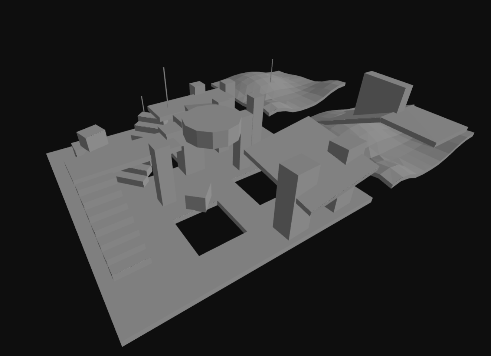

```cpp
struct BuildContext {
    Array<BuildContextLog> logs;
};
```

#### 1. Mark walkable triangles

The first step finds the walkable triangles, by checking each one's slope against the steepest walkable slope.
Walkable triangles are marked with `WALKABLE_AREA` (`1`).

```cpp
// CONFIG: agent walkable slope angle
const float walkable_slope_angle_degrees = 45;

// one area id per triangle: WALKABLE_AREA where the slope is walkable, NULL_AREA elsewhere
Array<uint8_t> tri_area_ids = {};
tri_area_ids.resize(mesh.indices.length / 3, NULL_AREA);
input_triangle_mesh::mark_walkable_triangles(tri_area_ids, mesh, walkable_slope_angle_degrees);
```

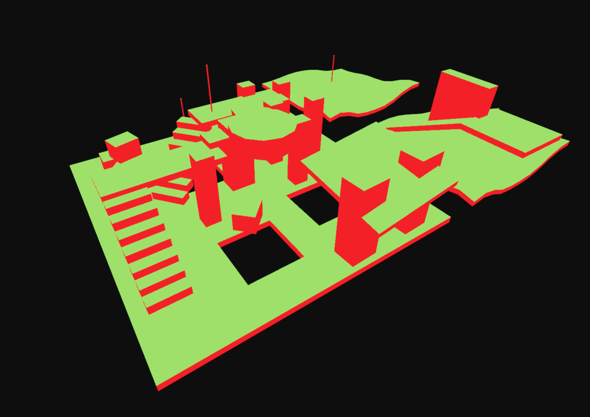

```cpp
void input_triangle_mesh::mark_walkable_triangles(
    Span<uint8_t> tri_area_ids, const InputTriangleMesh &mesh, float walkable_slope_angle = 45.0f);

DebugPrimitives debug::create_triangle_area_ids_helper(
    const InputTriangleMesh &mesh, Span<const uint8_t> tri_area_ids);
```

#### 2. Rasterize triangles into a heightfield, do filtering with the heightfield

The triangles are then voxelised into a heightfield: columns of solid spans, each carrying the walkability of the
triangles that made it.

The heightfield is then filtered to remove spans where an agent cannot stand: low obstacles it can step over become
walkable, while ledges and spans without the headroom it needs do not.

The heightfield's resolution greatly affects both the fidelity of the nav mesh and how long generation takes.

`heightfield::rasterize_sphere`, `rasterize_capsule`, `rasterize_cylinder`, `rasterize_box` and `rasterize_convex` add
shapes that are not triangles (see [Rasterize Filled Volume](./demos/examples/example_rasterize_filled_volume.cpp)).

```cpp
// CONFIG: heightfield cell size and height, in world units
const float cell_size = 0.2f;
const float cell_height = 0.2f;

// CONFIG: agent walkable climb
const float walkable_climb_world = 0.4f;
const int walkable_climb_voxels = (int)ceilf(walkable_climb_world / cell_height);

// CONFIG: agent walkable height
const float walkable_height_world = 1.8f;
const int walkable_height_voxels = (int)ceilf(walkable_height_world / cell_height);

// the bounds of the input, and the heightfield's grid over it
const Box3 bounds = input_triangle_mesh::calculate_mesh_bounds(mesh);
const GridSize grid = heightfield::calculate_grid_size(bounds, cell_size);
Heightfield solid = heightfield::create(grid.width, grid.height, bounds, cell_size, cell_height);

// rasterise the triangles into the heightfield
heightfield::rasterize_triangles(context, solid, mesh, tri_area_ids, walkable_climb_voxels);

// filter out the spans an agent cannot stand on
heightfield::filter_low_hanging_walkable_obstacles(solid, walkable_climb_voxels);
heightfield::filter_ledge_spans(solid, walkable_height_voxels, walkable_climb_voxels);
heightfield::filter_walkable_low_height_spans(solid, walkable_height_voxels);
```

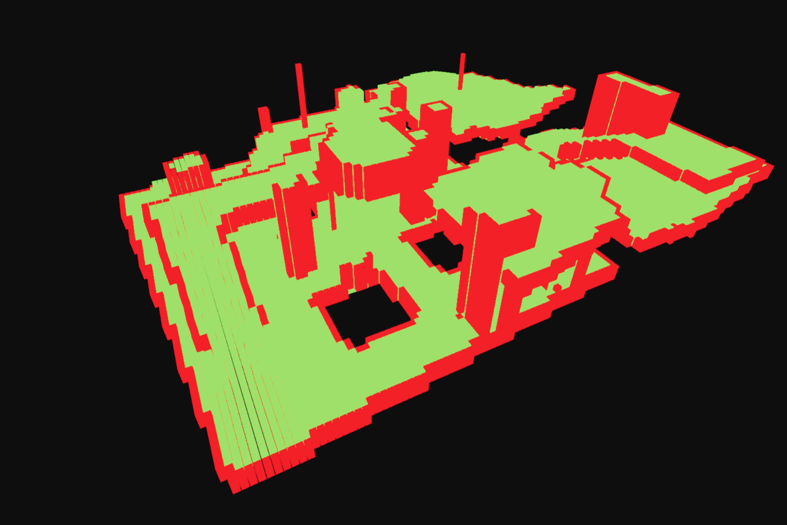

```cpp
Heightfield heightfield::create(
    int width, int height, Box3 bounds, float cell_size, float cell_height);

bool heightfield::rasterize_triangles(
    BuildContext &context, Heightfield &heightfield, const InputTriangleMesh &mesh,
    Span<const uint8_t> tri_area_ids, int flag_merge_threshold = 1);

void heightfield::filter_low_hanging_walkable_obstacles(
    Heightfield &heightfield, int walkable_climb);

void heightfield::filter_ledge_spans(
    Heightfield &heightfield, int walkable_height, int walkable_climb);

void heightfield::filter_walkable_low_height_spans(Heightfield &heightfield, int walkable_height);

DebugPrimitives debug::create_heightfield_helper(const Heightfield &heightfield);
```

#### 3. Build compact heightfield, erode walkable area, mark areas

The heightfield is then compacted to the open space above each walkable span, with each span's neighbours.

The compact heightfield is eroded by the agent's radius, so that the nav mesh keeps an agent of that radius off walls.

Areas marked now become the area of the polys over them: `mark_box_area`, `mark_rotated_box_area`,
`mark_convex_poly_area` and `mark_cylinder_area` (see
[Mark Compact Heightfield Areas](./demos/examples/example_mark_compact_heightfield_areas.cpp)).

```cpp
// CONFIG: agent radius
const float walkable_radius_world = 0.3f;
const int walkable_radius_voxels = (int)ceilf(walkable_radius_world / cell_size);

// the open space above the solid spans, with each span's neighbours
CompactHeightfield compact = compact_heightfield::build(context, solid, walkable_height_voxels,
                                                        walkable_climb_voxels);

// erode the walkable area by the agent's radius
compact_heightfield::erode_walkable_area(compact, walkable_radius_voxels);

// OPTIONAL: mark areas of your own. area ids are yours to give meaning to, see "Custom Query
// Filters and Custom Area Types"
const Box3 pond = {{-10, -1, 4}, {-4, 1, 10}};
compact_heightfield::mark_box_area(compact, pond, AREA_WATER);
```

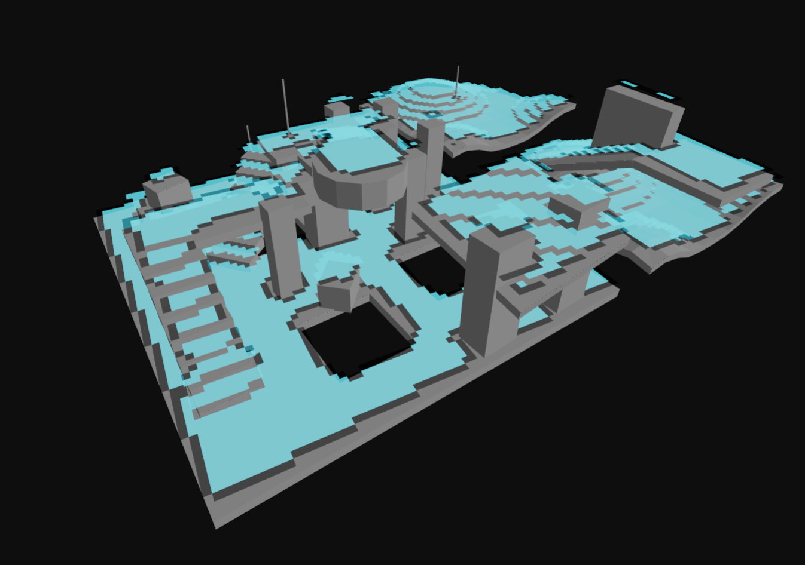

`erode_and_mark_walkable_areas` erodes by the smallest agent's radius and marks narrower areas with area ids of their
own, for several agent sizes on one nav mesh: filters for larger agents then exclude those areas. It needs a cell size
small enough to represent narrow passages, thresholds of more than a voxel or two, and often does better with
`build_regions_monotone` (see [Multiple Agent Sizes](./demos/examples/example_multiple_agent_sizes.cpp)).

```cpp
CompactHeightfield compact_heightfield::build(
    BuildContext &context, const Heightfield &heightfield, int walkable_height_voxels,
    int walkable_climb_voxels);

void compact_heightfield::erode_walkable_area(
    CompactHeightfield &compact_heightfield, int walkable_radius_voxels);

void compact_heightfield::erode_and_mark_walkable_areas(
    CompactHeightfield &compact_heightfield, int base_walkable_radius_voxels,
    Span<const WalkableAreaThreshold> thresholds);

DebugPrimitives debug::create_compact_heightfield_solid_helper(
    const CompactHeightfield &compact_heightfield);
```

#### 4. Build compact heightfield regions

The compact heightfield is then split into regions, each simple enough to become polygons.

Watershed partitioning, the presets' choice, first computes a distance field: each span's distance from the nearest
edge.

```cpp
// CONFIG: border size, in voxels: 0 for a solo nav mesh, the agent radius plus a few voxels
// for a tiled one
const int border_size = 0;

// CONFIG: min region area and merge region area, in voxels
const int min_region_area = 8;
const int merge_region_area = 20;

// prepare for watershed partitioning with a distance field along the walkable surface
compact_heightfield_regions::build_distance_field(compact);

// split the walkable surface into simple regions without holes
compact_heightfield_regions::build_regions(context, compact, border_size, min_region_area,
                                           merge_region_area);
```

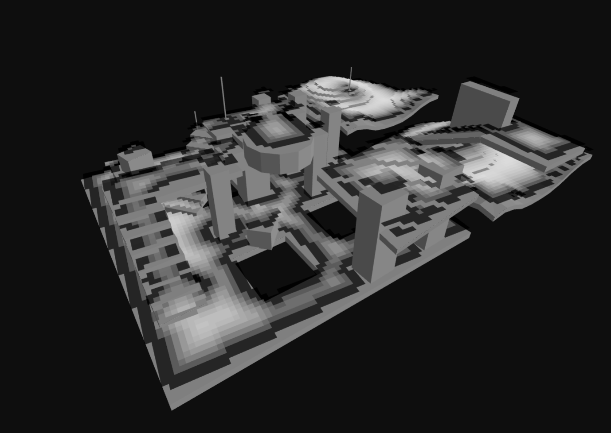

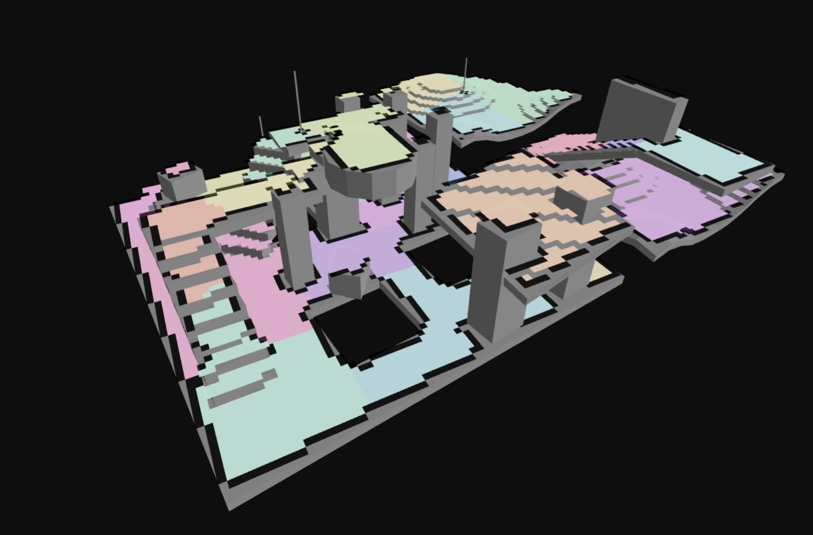

Watershed gives the best polygons. `build_regions_monotone` sweeps the heightfield instead, which is fastest, needs no
distance field and makes no overlapping regions, but can give long thin polygons. `build_layer_regions` handles
overlapping walkable areas by making separate layers, and suits tiles with floors above each other.

```cpp
void compact_heightfield_regions::build_distance_field(CompactHeightfield &compact_heightfield);

bool compact_heightfield_regions::build_regions(
    BuildContext &context, CompactHeightfield &compact_heightfield, int border_size,
    int min_region_area, int merge_region_area);

bool compact_heightfield_regions::build_regions_monotone(
    BuildContext &context, CompactHeightfield &compact_heightfield, int border_size,
    int min_region_area, int merge_region_area);

bool compact_heightfield_regions::build_layer_regions(
    BuildContext &context, CompactHeightfield &compact_heightfield, int border_size,
    int min_region_area);

DebugPrimitives debug::create_compact_heightfield_distances_helper(
    const CompactHeightfield &compact_heightfield);

DebugPrimitives debug::create_compact_heightfield_regions_helper(
    const CompactHeightfield &compact_heightfield);
```

#### 5. Build contours from compact heightfield regions

Contours are traced around the edges of the regions, then simplified to fewer vertices while keeping their overall
shape.

```cpp
// CONFIG: max simplification error, in voxels
const float max_simplification_error = 1.3f;

// CONFIG: max edge length, in voxels
const int max_edge_length = 12;

// trace and simplify the regions' outlines
ContourSet contours = contour_set::build_contours(context, compact, max_simplification_error,
                                                  max_edge_length, CONTOUR_TESS_WALL_EDGES);
```

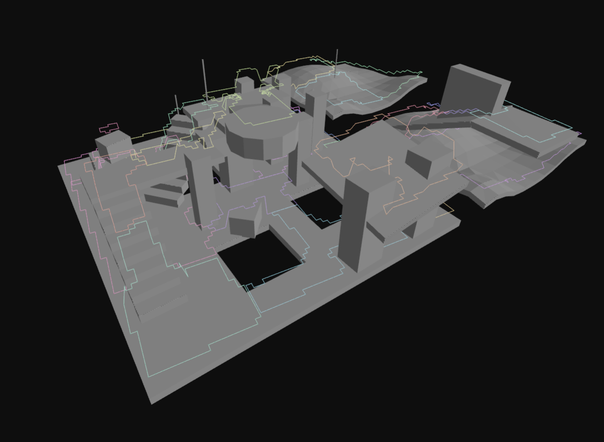

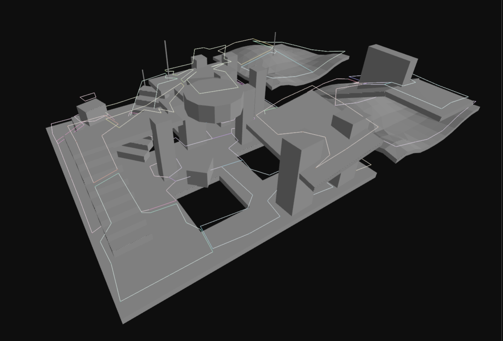

```cpp
ContourSet contour_set::build_contours(
    BuildContext &context, const CompactHeightfield &compact_heightfield,
    float max_simplification_error, int max_edge_length, uint32_t build_flags);

DebugPrimitives debug::create_raw_contours_helper(const ContourSet &contour_set);

DebugPrimitives debug::create_simplified_contours_helper(const ContourSet &contour_set);
```

#### 6. Build polygon mesh from contours, build detail mesh

From the simplified contours, a polygon mesh is made: convex polygons covering the walkable areas. Each poly carries an
area (what it is) and flags (who may use it), both yours to set.

A detail triangle mesh is also built, to keep the heights the polygons lost, sampled from the compact heightfield.

```cpp
// CONFIG: max vertices per polygon: 3 to 6, higher gives fewer but more complex polys
const int max_vertices_per_poly = 6;

PolyMesh polys = poly_mesh::build_poly_mesh(context, contours, max_vertices_per_poly);

// give each poly an area and flags. the presets give every walkable poly area 0 and flags 1;
// here walkers may use the ground and swimmers the water too
for (uint32_t i = 0; i < (uint32_t)polys.poly_count; i++) {
    if (polys.areas[i] == WALKABLE_AREA) {
        polys.areas[i] = AREA_GROUND;
        polys.flags[i] = FLAG_WALK;
    } else if (polys.areas[i] == AREA_WATER) {
        polys.flags[i] = FLAG_SWIM;
    }
}

// CONFIG: detail mesh sample distance and max sample error, in world units
const float sample_distance = 6 * cell_size;
const float sample_max_error = 1 * cell_height;

PolyMeshDetail detail = poly_mesh_detail::build_poly_mesh_detail(context, polys, compact,
                                                                 sample_distance, sample_max_error);
```

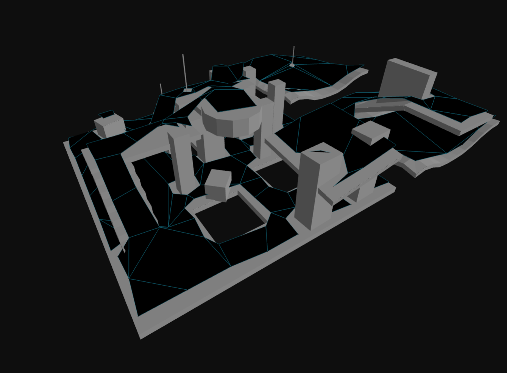

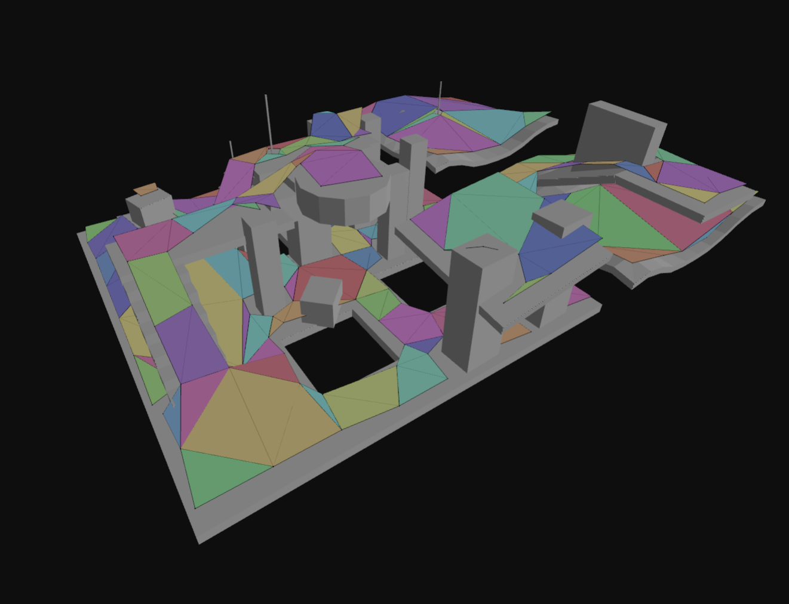

```cpp
PolyMesh poly_mesh::build_poly_mesh(
    BuildContext &context, const ContourSet &contour_set, int max_vertices_per_poly);

PolyMeshDetail poly_mesh_detail::build_poly_mesh_detail(
    BuildContext &context, const PolyMesh &poly_mesh, const CompactHeightfield &compact_heightfield,
    float sample_distance, float sample_max_error);

DebugPrimitives debug::create_poly_mesh_helper(const PolyMesh &poly_mesh);

DebugPrimitives debug::create_poly_mesh_detail_helper(const PolyMeshDetail &poly_mesh_detail);
```

#### 7. Convert build-time poly mesh and poly mesh detail to runtime navmesh tile format

Next, the poly mesh and detail mesh are converted from the build-time format to the runtime tile format, which works
out each poly's neighbours along its edges.

```cpp
// the build-time meshes in the runtime tile format
NavMeshTilePolys tile_polys = nav_mesh_tile::poly_mesh_to_tile_polys(polys);
NavMeshTileDetailMesh tile_detail =
    nav_mesh_tile::poly_mesh_detail_to_tile_detail_mesh(tile_polys.polys, detail);
```

```cpp
NavMeshTilePolys nav_mesh_tile::poly_mesh_to_tile_polys(const PolyMesh &poly_mesh);

NavMeshTileDetailMesh nav_mesh_tile::poly_mesh_detail_to_tile_detail_mesh(
    const Array<NavMeshPoly> &polys, const PolyMeshDetail &poly_mesh_detail);
```

#### 8. Assemble the navigation mesh

Finally, the tile is built (which makes its BV tree) and added to a nav mesh, ready for queries.

```cpp
const NavMeshTileParams params = {
    .bounds = polys.bounds,
    .vertices = tile_polys.vertices,
    .polys = tile_polys.polys,
    .poly_vertices = tile_polys.poly_vertices,
    .poly_neis = tile_polys.poly_neis,
    .detail_meshes = tile_detail.detail_meshes,
    .detail_vertices = tile_detail.detail_vertices,
    .detail_triangles = tile_detail.detail_triangles,
    .tile_x = 0,
    .tile_y = 0,
    .tile_layer = 0,
    .cell_size = cell_size,
    .cell_height = cell_height,
    .walkable_height = walkable_height_world,
    .walkable_radius = walkable_radius_world,
    .walkable_climb = walkable_climb_world,
};

// a nav mesh one tile wide: the tile's size is the poly mesh's bounds
NavMesh nav_mesh = nav_mesh_api::create_nav_mesh();
nav_mesh.origin = polys.bounds.min;
nav_mesh.tile_width = polys.bounds.max.x - polys.bounds.min.x;
nav_mesh.tile_height = polys.bounds.max.z - polys.bounds.min.z;

// build the tile, which makes its BV tree, and add it
nav_mesh_api::add_tile(nav_mesh, nav_mesh_api::build_tile(params));
```


```cpp
// build_tile copied what it needs: everything else can go
nav_mesh_tile::release(tile_polys);
nav_mesh_tile::release(tile_detail);
poly_mesh_detail::release(detail);
poly_mesh::release(polys);
contour_set::release(contours);
compact_heightfield::release(compact);
heightfield::release(solid);
tri_area_ids.release();
build_context::release(context);
```

A tiled build does the same per tile, over the triangles under that tile and its border, with the tile's grid position
in the tile params and the nav mesh's `origin`, `tile_width` and `tile_height` set once for the grid. Read
[`generate_tiled_nav_mesh.cpp`](./roam/blocks/generators/generate_tiled_nav_mesh.cpp) for how.

```cpp
NavMesh nav_mesh_api::create_nav_mesh();
NavMeshTile nav_mesh_api::build_tile(const NavMeshTileParams &params);
uint32_t nav_mesh_api::add_tile(NavMesh &nav_mesh, NavMeshTile tile);
bool nav_mesh_api::remove_tile(NavMesh &nav_mesh, int x, int y, int layer);
DebugPrimitives debug::create_nav_mesh_helper(const NavMesh &nav_mesh);
```

### Post-Processing

A common post-processing step is to flood fill the nav mesh from seed points where agents can be (spawn points, say),
to find areas no agent can reach. Generation marks every walkable surface, including the tops of walls and furniture
and pockets inside closed geometry.

The `flood_fill_nav_mesh` block finds what is reachable and what is not:

```cpp
// every poly reachable from the seeds, and every one that is not: the polys to prune
const NodeRef seeds[] = {spawn.node_ref};
Array<NodeRef> unreachable = {};
unreachable.reserve(nav_mesh_api::get_max_node_count(nav_mesh));
FloodFillNavMeshResult flood = {};
flood_fill_nav_mesh::flood_fill_nav_mesh(flood, nav_mesh, seeds, {}, unreachable);
unreachable.resize(flood.unreachable_count);
printf("%u reachable, %u not\n", flood.reachable_total, flood.unreachable_total);
```

The Flood Fill Pruning example builds a new nav mesh without the unreachable polys:

<table>
  <tr>
    <td align="center">
      <a href="https://isaac-mason.github.io/roam/?example=example_flood_fill_pruning">
        <br/>
        <strong>Flood Fill Pruning</strong>
      </a><br/>
      <sub><a href="./demos/examples/example_flood_fill_pruning.cpp">source</a></sub>
    </td>
  </tr>
</table>

### Custom Query Filters and Custom Area Types

Each poly has an `area` and `flags`. The area is what the ground is (grass, water, a road); the flags say who may use
it (walkers, swimmers, vehicles). Both are set at build time, or after, and both are yours to give meaning to. The
deep dive above uses these:

```cpp
// the game's own area ids and flags: roam gives them no meaning
constexpr uint8_t AREA_GROUND = 0;
constexpr uint8_t AREA_WATER = 2;
constexpr uint32_t FLAG_WALK = 1;
constexpr uint32_t FLAG_SWIM = 2;
```

The presets give their polys area 0 and flags 1. Built step by step, polys start with flags 0, so set
flags for every area you mark: a poly with no flags passes no filter that checks flags, the default one included.

Most queries take a `QueryFilter`: two functions and their data. `pass_filter` decides whether a query may use a node,
and `get_cost` what crossing it costs. The default, `pass_flags`, checks the node's flags against `include_flags` and
`exclude_flags`:

```cpp
// a poly passes when its flags share a bit with include_flags and none with exclude_flags
QueryFilter walkers = nav_mesh_api::create_default_query_filter();
walkers.include_flags = FLAG_WALK;
QueryFilter swimmers = nav_mesh_api::create_default_query_filter();
swimmers.include_flags = FLAG_WALK | FLAG_SWIM;
```

A cost function makes some ground dearer than other: paths take it only where it saves enough. Its `user_data` is
yours:

```cpp
struct AreaCosts {
    float ground;
    float water;
};

// a filter's cost is for the step from pa to pb across current_ref: here the distance, scaled
// by its area's cost
float area_cost(const QueryFilter &filter, Vec3 pa, Vec3 pb, const NavMesh &nav_mesh, NodeRef,
                NodeRef current_ref, NodeRef) {
    const AreaCosts &costs = *static_cast<const AreaCosts *>(filter.user_data);
    const uint8_t area = nav_mesh_api::get_node_by_ref(nav_mesh, current_ref).area;
    return vec3::distance(pa, pb) * (area == AREA_WATER ? costs.water : costs.ground);
}
```

```cpp
// swimming is allowed but costs four times walking: paths go round the water where that is
// shorter
AreaCosts costs = {.ground = 1, .water = 4};
QueryFilter careful = {
    .pass_filter = nav_mesh_api::pass_flags,
    .get_cost = area_cost,
    .include_flags = FLAG_WALK | FLAG_SWIM,
    .exclude_flags = 0,
    .user_data = &costs,
};

StraightPathPoint points[64];
FindPathResult path = {};
find_path::find_path(path, workspace, nav_mesh, {-9, 0, 2}, {-3, 0, 9}, {1, 1, 1}, careful,
                     points);
```

The default functions are recognised and inlined in the searches, so a filter that needs only flags is fastest with
`pass_flags` and `distance_cost`. `ANY_QUERY_FILTER` passes every node, flags or not.

<table>
  <tr>
    <td align="center">
      <a href="https://isaac-mason.github.io/roam/?example=example_area_filters">
        <br/>
        <strong>Area Filters</strong>
      </a><br/>
      <sub><a href="./demos/examples/example_area_filters.cpp">source</a></sub>
    </td>
    <td align="center">
      <a href="https://isaac-mason.github.io/roam/?example=example_area_costs">
        <br/>
        <strong>Area Costs</strong>
      </a><br/>
      <sub><a href="./demos/examples/example_area_costs.cpp">source</a></sub>
    </td>
    <td align="center">
      <a href="https://isaac-mason.github.io/roam/?example=example_multiple_agent_sizes">
        <br/>
        <strong>Multiple Agent Sizes</strong>
      </a><br/>
      <sub><a href="./demos/examples/example_multiple_agent_sizes.cpp">source</a></sub>
    </td>
    <td align="center">
      <a href="https://isaac-mason.github.io/roam/?example=example_doors_and_keys">
        <br/>
        <strong>Doors and Keys</strong>
      </a><br/>
      <sub><a href="./demos/examples/example_doors_and_keys.cpp">source</a></sub>
    </td>
  </tr>
</table>

### Off-Mesh Connections

Off-mesh connections join places the nav mesh's polys do not: a jump across a gap or down a ledge, a ladder, a
teleporter, a door.

**When to use:** When your environment has gaps, vertical transitions or traversal mechanics that polys can't
represent. Pathfinding considers them like any other node.

They are part of the nav mesh, not of a tile: each end attaches to the polys under it, and attaches again as tiles are
added and removed, so they can be added and removed at any time, work between any tiles, and survive rebuilding them.
Each has an area and flags, as polys do, and filters treat it as a node like any other.

#### Point connections

A point connection goes from one point to another, one way or both ways.

```cpp
// a jump up onto the platform: from a point on the floor to a point on top, one way. each
// end attaches to the nearest poly within the radius, and attaches again as tiles come and go
const OffMeshConnectionParams jump_params = {
    .start = {6.5f, 0, -3.8f},
    .end = {6.5f, 1, -6},
    .radius = 0.5f,
    .direction = OFF_MESH_CONNECTION_DIRECTION_START_TO_END,
    .flags = 0xffffffff,
    .area = 0,
};
const uint32_t jump = nav_mesh_api::add_off_mesh_connection(nav_mesh, jump_params);
if (!nav_mesh_api::is_off_mesh_connection_connected(nav_mesh, jump)) {
    printf("an end found no poly\n");
}
```

A path that takes it has an off-mesh point where it leaves, then the point where it lands:

```cpp
// a path up takes the jump: the point where it leaves the floor is an off-mesh point, and
// the next is where it lands
StraightPathPoint points[32];
FindPathResult path = {};
find_path::find_path(path, workspace, nav_mesh, {0, 0, -6}, {7, 1, -7}, {1, 1, 1}, filter,
                     points);
for (uint32_t i = 0; i + 1 < path.point_count; i++) {
    if (points[i].type != NODE_TYPE_OFFMESH) continue;
    const Vec3 from = points[i].position;
    const Vec3 to = points[i + 1].position;
    printf("jump from %.2f %.2f %.2f", from.x, from.y, from.z);
    printf(" to %.2f %.2f %.2f\n", to.x, to.y, to.z);
}
```

```cpp
nav_mesh_api::remove_off_mesh_connection(nav_mesh, jump);
```

<table>
  <tr>
    <td align="center">
      <a href="https://isaac-mason.github.io/roam/?example=example_off_mesh_connections">
        <br/>
        <strong>Off-Mesh Connections</strong>
      </a><br/>
      <sub><a href="./demos/examples/example_off_mesh_connections.cpp">source</a></sub>
    </td>
  </tr>
</table>

#### Segment connections

A segment connection is wide: it joins a whole edge to another, such as the length of a ledge to the floor below it,
and a path crosses it wherever along it suits the path. `start_a` maps to `end_a` and `start_b` to `end_b`, and each
point between to the point the same fraction along the other. Agents coming from different places cross at different
points, rather than all at one.

```cpp
// the whole front edge of the platform as one wide link: from anywhere along the floor's
// edge (start_a to start_b) up to the matching place along the top (end_a to end_b). it is
// split into a piece per pair of polys it joins, and a path crosses where its funnel meets
// it. inset keeps crossings this far from the ends
const OffMeshSegmentConnectionParams ledge_params = {
    .start_a = {4.5f, 0, -4.4f},
    .start_b = {8.5f, 0, -4.4f},
    .end_a = {4.5f, 1, -5.6f},
    .end_b = {8.5f, 1, -5.6f},
    .radius = 0.6f,
    .inset = 0.3f,
    .direction = OFF_MESH_CONNECTION_DIRECTION_BIDIRECTIONAL,
    .flags = 0xffffffff,
    .area = 0,
    .align = false,
};
const uint32_t ledge = nav_mesh_api::add_off_mesh_segment_connection(nav_mesh, ledge_params);

// a link from a centre line and a width, as Unity's are
const OffMeshSegmentConnectionParams wide = nav_mesh_api::off_mesh_segment_connection_from_width(
    {6.5f, 0, -4.4f}, {6.5f, 1, -5.6f}, 4, 0.6f, OFF_MESH_CONNECTION_DIRECTION_BIDIRECTIONAL,
    0xffffffff, 0);
```

roam splits a segment connection into pieces, one per pair of polys it joins, and maps each piece's crossing at the
same fraction along both ends. `align` swaps `end_a` and `end_b` when that uncrosses the mapping.

<table>
  <tr>
    <td align="center">
      <a href="https://isaac-mason.github.io/roam/?example=example_segment_off_mesh_connections">
        <br/>
        <strong>Segment Off-Mesh Connections</strong>
      </a><br/>
      <sub><a href="./demos/examples/example_segment_off_mesh_connections.cpp">source</a></sub>
    </td>
  </tr>
</table>

## Advanced Navigation Mesh APIs

This section covers lower-level APIs for working with the nav mesh's structure. Most users won't need them for
everyday pathfinding, but they are useful for understanding the internals, building
[custom pathfinding algorithms](#custom-pathfinding-algorithms), or debugging.

### Nodes and refs

A `NodeRef` names a node: a poly or an off-mesh connection. It is a `uint64_t`, with `INVALID_NODE_REF` for none
(0 is a valid ref).

```cpp
// a ref packs the node's type, its index in nav_mesh.nodes and its tile's sequence. removing
// a tile and adding another bumps the sequence, so a ref kept from before no longer resolves
if (nav_mesh_api::is_valid_node_ref(nav_mesh, node_ref)) {
    const NavMeshNode &node = nav_mesh_api::get_node_by_ref(nav_mesh, node_ref);
    const char *type = node.type == NODE_TYPE_POLY ? "a poly" : "an off-mesh connection";
    printf("%s, area %u, flags %u\n", type, node.area, node.flags);
}

// a poly's tile and record, and its vertices in world space
TileAndPoly found = nav_mesh_api::get_tile_and_poly_by_ref(nav_mesh, node_ref);
if (found.success) {
    for (uint32_t i = 0; i < found.poly->vertex_count; i++) {
        const uint32_t index = found.tile->poly_vertices[found.poly->vertex_base + i];
        const Vec3 vertex = vec3::load(found.tile->vertices.data, index * 3);
        printf("  %.2f %.2f %.2f\n", vertex.x, vertex.y, vertex.z);
    }
}

// every node and the links leaving it: the graph that searches walk
for (const NavMeshNode &node : nav_mesh.nodes) {
    if (!node.allocated) continue;
    for (int32_t link_index = node.first_link; link_index != NULL_LINK;) {
        const NavMeshLink &link = nav_mesh.links[(uint32_t)link_index];
        const NodeRef neighbour = link.to_node_ref;
        (void)neighbour;
        link_index = link.next;
    }
}
```

Everything in `NavMesh` and `NavMeshTile` is there to read. Change a nav mesh only through `nav_mesh_api`.

### Tiles

`add_tile` takes a built tile, links it with its neighbours and the off-mesh connections that reach it, and returns
its id. `remove_tile` takes one out by grid position. A tile's polys get new refs each time it is added, so hold refs,
not pointers, and check old refs with `is_valid_node_ref`. Never keep a tile pointer across `add_tile` or
`remove_tile`.

```cpp
// the tile at a grid position, and the grid position of a point
const Vec2 cell = nav_mesh_api::world_to_tile_position(nav_mesh, {0, 0, 0});
const int x = (int)cell.x;
const int y = (int)cell.y;
const NavMeshTile *tile = nav_mesh_api::get_tile_at(nav_mesh, x, y, 0);

// a copy of it, as bytes, before taking it out: its polys' refs go with it
SaveResult size = {};
nav_mesh_io::save_tile(size, *tile, {});
Array<uint8_t> bytes = {};
bytes.resize(size.byte_total);
SaveResult saved = {};
nav_mesh_io::save_tile(saved, *tile, bytes);
nav_mesh_api::remove_tile(nav_mesh, x, y, 0);

// and back: add_tile takes the tile, links it to its neighbours and returns its id
NavMeshTile copy = {};
if (nav_mesh_io::load_tile(copy, bytes) == LOAD_STATUS_OK) nav_mesh_api::add_tile(nav_mesh, copy);
bytes.release();
```

Tiles at the same `tile_x` and `tile_y` with different `tile_layer`s stack in one column, for floors above each other.

### Polys

Smaller queries over polys: those in a box, the closest point on one, and the edge two share. `get_poly_height` gives
the detail mesh's height under a point, `get_closest_point_on_poly_boundary` the nearest point on a poly's edge.

```cpp
// every poly whose bounds overlap a box
const Box3 box = {{-10, -1, -10}, {0, 1, 0}};
NodeRef found[64];
QueryPolygonsResult query = {};
nav_mesh_api::query_polygons(query, nav_mesh, box, filter, found);

// the nearest point on a poly to a point, and whether the point is over the poly
GetClosestPointOnPolyResult closest = {};
nav_mesh_api::get_closest_point_on_poly(closest, nav_mesh, node_ref, {-8, 3, 0});

// the shared edge between two neighbouring polys, as the funnel sees it
GetPortalPointsResult portal = {};
if (query.poly_count > 1) nav_mesh_search::get_portal_points(portal, nav_mesh, found[0], found[1]);
```

## Using Externally Created Navigation Meshes

A nav mesh does not have to come from triangles. You can bring your own polygons, authored by hand or made with another
tool: `polygons_to_nav_mesh_tile_polys` makes a tile's polys from convex polygons, and `polys_to_tile_detail_mesh` makes
a detail mesh for them, or you can provide your own if you have height data.

```cpp
// two squares side by side, sharing an edge: indexed vertices, so shared edges become links
const float vertices[] = {0, 0, 0, 4, 0, 0, 8, 0, 0, 0, 0, 4, 4, 0, 4, 8, 0, 4};
const uint32_t left[] = {0, 3, 4, 1};
const uint32_t right[] = {1, 4, 5, 2};
const ExternalPolygon polygons[] = {
    {.vertices = left, .flags = 1, .area = 0},
    {.vertices = right, .flags = 1, .area = 0},
};
const Box3 bounds = {{0, 0, 0}, {8, 1, 4}};

NavMeshTilePolys tile_polys =
    nav_mesh_tile::polygons_to_nav_mesh_tile_polys(polygons, vertices, 0, bounds);
// no detail mesh of its own: one built from the polygons themselves
NavMeshTileDetailMesh tile_detail = nav_mesh_tile::polys_to_tile_detail_mesh(tile_polys.polys);

const NavMeshTileParams params = {
    .bounds = bounds,
    .vertices = tile_polys.vertices,
    .polys = tile_polys.polys,
    .poly_vertices = tile_polys.poly_vertices,
    .poly_neis = tile_polys.poly_neis,
    .detail_meshes = tile_detail.detail_meshes,
    .detail_vertices = tile_detail.detail_vertices,
    .detail_triangles = tile_detail.detail_triangles,
    .cell_size = 0.2f,
    .cell_height = 0.2f,
    .walkable_height = 1.8f,
    .walkable_radius = 0.3f,
    .walkable_climb = 0.4f,
};

NavMesh nav_mesh = nav_mesh_api::create_nav_mesh();
nav_mesh.origin = bounds.min;
nav_mesh.tile_width = 8;
nav_mesh.tile_height = 4;
nav_mesh_api::add_tile(nav_mesh, nav_mesh_api::build_tile(params));

nav_mesh_tile::release(tile_polys);
nav_mesh_tile::release(tile_detail);
```

Polygons must share vertices where they meet: neighbours are found by shared edges.

<table>
  <tr>
    <td align="center">
      <a href="https://isaac-mason.github.io/roam/?example=example_custom_gltf_nav_mesh">
        <br/>
        <strong>Custom GLTF NavMesh</strong>
      </a><br/>
      <sub><a href="./demos/examples/example_custom_gltf_nav_mesh.cpp">source</a></sub>
    </td>
  </tr>
</table>

## Saving and Loading NavMeshes

A saved nav mesh is a snapshot: its tiles, nodes, links and off-mesh connections, little-endian, floats bit for bit.
Loaded, it gives the same refs and the same query results as the one saved, and loading checks every count and index,
so bad data is refused with a status rather than read.

```cpp
// an empty buffer first, for the size; then the bytes
SaveResult size = {};
nav_mesh_io::save_nav_mesh(size, nav_mesh, {});
Array<uint8_t> bytes = {};
bytes.resize(size.byte_total);
SaveResult saved = {};
nav_mesh_io::save_nav_mesh(saved, nav_mesh, bytes);

// the same nav mesh back: the same refs, the same query results
NavMesh loaded = {};
const LoadStatus status = nav_mesh_io::load_nav_mesh(loaded, bytes);
if (status != LOAD_STATUS_OK) printf("not a nav mesh: %u\n", status);
```

`save_tile` and `load_tile` do the same for one tile, as in [Tiles](#tiles): a tile built offline, or kept to add
again later. A saved tile has no links; `add_tile` makes them.

## Geometry Blocks

Two small blocks for preparing generation input, in `roam/blocks/geometry/`.

`merge_positions_and_indices` joins meshes from several sources into one, merging vertices at the same position so
their triangles connect:

```cpp
const InputTriangleMesh meshes[] = {
    {level.positions, level.indices},
    {extra_positions, extra_indices},
};
MergedMesh merged = merge_positions_and_indices::merge_positions_and_indices(meshes);
const InputTriangleMesh input = {merged.positions, merged.indices};
```

`chunky_tri_mesh` buckets triangles in xz, to find the triangles under an area without visiting them all. It is what
the tiled generator builds each tile from:

```cpp
ChunkyTriMesh chunks = chunky_tri_mesh::create(input, 256);

uint32_t nodes[64];
ChunkyTriMeshChunksResult found = {};
chunky_tri_mesh::get_chunks_overlapping_rect(found, chunks, {-4, -4}, {4, 4}, nodes);
for (uint32_t n = 0; n < found.chunk_count; n++) {
    const ChunkyTriMeshNode &node = chunks.nodes[nodes[n]];
    for (uint32_t i = 0; i < node.count; i++) {
        const uint32_t triangle = chunks.triangles[(uint32_t)node.index + i];
        (void)triangle;
    }
}

chunky_tri_mesh::release(chunks);
```

<table>
  <tr>
    <td align="center">
      <a href="https://isaac-mason.github.io/roam/?example=example_chunky_tri_mesh">
        <br/>
        <strong>Chunky Tri Mesh</strong>
      </a><br/>
      <sub><a href="./demos/examples/example_chunky_tri_mesh.cpp">source</a></sub>
    </td>
  </tr>
</table>

## Debug Utilities

`roam/debug/debug.h` turns each stage of generation, and the nav mesh itself, into renderer-agnostic primitives:
triangles, lines, points or boxes, each with positions, colours and indices. They draw nothing themselves; write a few
lines to draw them with whatever you render with, as the demo app does with sokol.

```cpp
// each stage of generation
DebugPrimitives triangle_area_ids = debug::create_triangle_area_ids_helper(mesh, tri_area_ids);
DebugPrimitives heightfield = debug::create_heightfield_helper(solid);
DebugPrimitives compact_solid = debug::create_compact_heightfield_solid_helper(compact);
DebugPrimitives distances = debug::create_compact_heightfield_distances_helper(compact);
DebugPrimitives regions = debug::create_compact_heightfield_regions_helper(compact);
DebugPrimitives raw_contours = debug::create_raw_contours_helper(contours);
DebugPrimitives simplified_contours = debug::create_simplified_contours_helper(contours);
DebugPrimitives poly_mesh = debug::create_poly_mesh_helper(polys);
DebugPrimitives poly_mesh_detail = debug::create_poly_mesh_detail_helper(detail);

// the nav mesh
DebugPrimitives nav_mesh_triangles = debug::create_nav_mesh_helper(nav_mesh);
DebugPrimitives nav_mesh_tile = debug::create_nav_mesh_tile_helper(tile);
DebugPrimitives nav_mesh_poly = debug::create_nav_mesh_poly_helper(nav_mesh, node_ref);
DebugPrimitives islands = debug::create_nav_mesh_islands_helper(nav_mesh);
DebugPrimitives tile_bv_tree = debug::create_nav_mesh_tile_bv_tree_helper(tile);
DebugPrimitives bv_tree = debug::create_nav_mesh_bv_tree_helper(nav_mesh);
DebugPrimitives links = debug::create_nav_mesh_links_helper(nav_mesh);
DebugPrimitives tile_portals = debug::create_nav_mesh_tile_portals_helper(tile);
DebugPrimitives portals = debug::create_nav_mesh_portals_helper(nav_mesh);
DebugPrimitives off_mesh = debug::create_nav_mesh_off_mesh_connections_helper(nav_mesh);

// the nodes the last search through this workspace visited
DebugPrimitives search_nodes = debug::create_search_nodes_helper(workspace);
```

```cpp
DebugPrimitives primitives = debug::create_nav_mesh_helper(nav_mesh);
for (const DebugPrimitive &primitive : primitives) {
    if (primitive.type == DEBUG_PRIMITIVE_TRIANGLES) {
        printf("%u triangles\n", primitive.indices.length / 3);
    } else if (primitive.type == DEBUG_PRIMITIVE_LINES) {
        printf("%u lines\n", primitive.positions.length / 6);
    }
}
debug::release(primitives);
```

## Demos

`demos/` is an app of examples, listed [at the top](#roam). Each is one file in `demos/examples/`. The app builds
natively and with Emscripten, and every push to `main` deploys the web build to
[isaac-mason.github.io/roam](https://isaac-mason.github.io/roam/). Open an example directly with `?example=<id>`, such
as [`?example=example_find_path`](https://isaac-mason.github.io/roam/?example=example_find_path); the URL follows the
example you pick, so it can be copied and shared. Natively, pass the id or name: `demos/native.sh example_find_path`.

```sh
demos/native.sh                 # build and run natively
demos/native.sh "find path"     # open an example by name
demos/web.sh                    # build with Emscripten (needs EMSDK) and serve on localhost:8080 (PORT overrides)
demos/smoke.sh                  # run every example headlessly for 30 frames, failing on crashes and leaks
demos/screenshots.sh            # render every example offscreen into demos/screenshots/
```

## Tests and Benchmarks

```sh
cmake --preset debug && cmake --build --preset debug && ctest --preset debug
```

The tests cover generation and queries, fuzz queries, tile churn and generation inputs, and check every test for
leaks.

This README is built from [`docs/README.template.md`](./docs/README.template.md) by `node docs/build.mjs`. Its code
comes from [`docs/snippets/`](./docs/snippets), which the tests compile and run (`roam_snippets` and
`roam_snippet_quickstart`), and its declarations are read from roam's headers, so none of it can drift from the code.
The `roam_readme` test fails when `README.md` is out of date. The example screenshots come from
`demos/screenshots.sh`, which renders every example offscreen (macOS only, for now).

`roam_bench` times generation and queries on a level fixture, best built with the `release` preset:
`build/release/roam_bench --fixture path/to/nav-test.json`.

## License

roam is [MIT licensed](./LICENSE).
